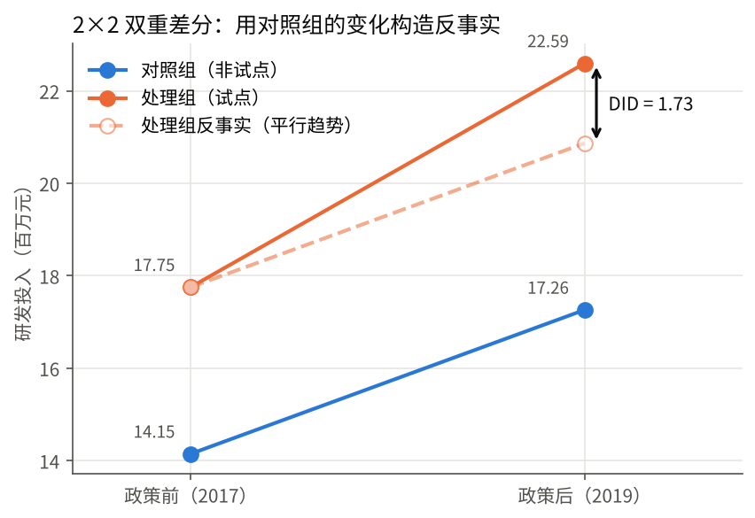

上一篇用加减法算出了 DID。这一篇我们回答两个更根本的问题：**DID 到底在估计什么？凭什么能估计出来？** 搞清楚这两点，后面所有的扩展（多期、交错、事件研究）都只是在这个框架上加东西。

<svg xmlns="http://www.w3.org/2000/svg" style="display:none" aria-hidden="true"><defs><path id="MJX-TEX-I-1D44C" d="M66 637Q54 637 49 637T39 638T32 641T30 647T33 664T42 682Q44 683 56 683Q104 680 165 680Q288 680 306 683H316Q322 677 322 674T320 656Q316 643 310 637H298Q242 637 242 624Q242 619 292 477T343 333L346 336Q350 340 358 349T379 373T411 410T454 461Q546 568 561 587T577 618Q577 634 545 637Q528 637 528 647Q528 649 530 661Q533 676 535 679T549 683Q551 683 578 682T657 680Q684 680 713 681T746 682Q763 682 763 673Q763 669 760 657T755 643Q753 637 734 637Q662 632 617 587Q608 578 477 424L348 273L322 169Q295 62 295 57Q295 46 363 46Q379 46 384 45T390 35Q390 33 388 23Q384 6 382 4T366 1Q361 1 324 1T232 2Q170 2 138 2T102 1Q84 1 84 9Q84 14 87 24Q88 27 89 30T90 35T91 39T93 42T96 44T101 45T107 45T116 46T129 46Q168 47 180 50T198 63Q201 68 227 171L252 274L129 623Q128 624 127 625T125 627T122 629T118 631T113 633T105 634T96 635T83 636T66 637Z"></path><path id="MJX-TEX-I-1D456" d="M184 600Q184 624 203 642T247 661Q265 661 277 649T290 619Q290 596 270 577T226 557Q211 557 198 567T184 600ZM21 287Q21 295 30 318T54 369T98 420T158 442Q197 442 223 419T250 357Q250 340 236 301T196 196T154 83Q149 61 149 51Q149 26 166 26Q175 26 185 29T208 43T235 78T260 137Q263 149 265 151T282 153Q302 153 302 143Q302 135 293 112T268 61T223 11T161 -11Q129 -11 102 10T74 74Q74 91 79 106T122 220Q160 321 166 341T173 380Q173 404 156 404H154Q124 404 99 371T61 287Q60 286 59 284T58 281T56 279T53 278T49 278T41 278H27Q21 284 21 287Z"></path><path id="MJX-TEX-I-1D461" d="M26 385Q19 392 19 395Q19 399 22 411T27 425Q29 430 36 430T87 431H140L159 511Q162 522 166 540T173 566T179 586T187 603T197 615T211 624T229 626Q247 625 254 615T261 596Q261 589 252 549T232 470L222 433Q222 431 272 431H323Q330 424 330 420Q330 398 317 385H210L174 240Q135 80 135 68Q135 26 162 26Q197 26 230 60T283 144Q285 150 288 151T303 153H307Q322 153 322 145Q322 142 319 133Q314 117 301 95T267 48T216 6T155 -11Q125 -11 98 4T59 56Q57 64 57 83V101L92 241Q127 382 128 383Q128 385 77 385H26Z"></path><path id="MJX-TEX-N-3D" d="M56 347Q56 360 70 367H707Q722 359 722 347Q722 336 708 328L390 327H72Q56 332 56 347ZM56 153Q56 168 72 173H708Q722 163 722 153Q722 140 707 133H70Q56 140 56 153Z"></path><path id="MJX-TEX-S3-7B" d="M618 -943L612 -949H582L568 -943Q472 -903 411 -841T332 -703Q327 -682 327 -653T325 -350Q324 -28 323 -18Q317 24 301 61T264 124T221 171T179 205T147 225T132 234Q130 238 130 250Q130 255 130 258T131 264T132 267T134 269T139 272T144 275Q207 308 256 367Q310 436 323 519Q324 529 325 851Q326 1124 326 1154T332 1205Q369 1358 566 1443L582 1450H612L618 1444V1429Q618 1413 616 1411L608 1406Q599 1402 585 1393T552 1372T515 1343T479 1305T449 1257T429 1200Q425 1180 425 1152T423 851Q422 579 422 549T416 498Q407 459 388 424T346 364T297 318T250 284T214 264T197 254L188 251L205 242Q290 200 345 138T416 3Q421 -18 421 -48T423 -349Q423 -397 423 -472Q424 -677 428 -694Q429 -697 429 -699Q434 -722 443 -743T465 -782T491 -816T519 -845T548 -868T574 -886T595 -899T610 -908L616 -910Q618 -912 618 -928V-943Z"></path><path id="MJX-TEX-N-28" d="M94 250Q94 319 104 381T127 488T164 576T202 643T244 695T277 729T302 750H315H319Q333 750 333 741Q333 738 316 720T275 667T226 581T184 443T167 250T184 58T225 -81T274 -167T316 -220T333 -241Q333 -250 318 -250H315H302L274 -226Q180 -141 137 -14T94 250Z"></path><path id="MJX-TEX-N-31" d="M213 578L200 573Q186 568 160 563T102 556H83V602H102Q149 604 189 617T245 641T273 663Q275 666 285 666Q294 666 302 660V361L303 61Q310 54 315 52T339 48T401 46H427V0H416Q395 3 257 3Q121 3 100 0H88V46H114Q136 46 152 46T177 47T193 50T201 52T207 57T213 61V578Z"></path><path id="MJX-TEX-N-29" d="M60 749L64 750Q69 750 74 750H86L114 726Q208 641 251 514T294 250Q294 182 284 119T261 12T224 -76T186 -143T145 -194T113 -227T90 -246Q87 -249 86 -250H74Q66 -250 63 -250T58 -247T55 -238Q56 -237 66 -225Q221 -64 221 250T66 725Q56 737 55 738Q55 746 60 749Z"></path><path id="MJX-TEX-N-2C" d="M78 35T78 60T94 103T137 121Q165 121 187 96T210 8Q210 -27 201 -60T180 -117T154 -158T130 -185T117 -194Q113 -194 104 -185T95 -172Q95 -168 106 -156T131 -126T157 -76T173 -3V9L172 8Q170 7 167 6T161 3T152 1T140 0Q113 0 96 17Z"></path><path id="MJX-TEX-I-1D437" d="M287 628Q287 635 230 637Q207 637 200 638T193 647Q193 655 197 667T204 682Q206 683 403 683Q570 682 590 682T630 676Q702 659 752 597T803 431Q803 275 696 151T444 3L430 1L236 0H125H72Q48 0 41 2T33 11Q33 13 36 25Q40 41 44 43T67 46Q94 46 127 49Q141 52 146 61Q149 65 218 339T287 628ZM703 469Q703 507 692 537T666 584T629 613T590 629T555 636Q553 636 541 636T512 636T479 637H436Q392 637 386 627Q384 623 313 339T242 52Q242 48 253 48T330 47Q335 47 349 47T373 46Q499 46 581 128Q617 164 640 212T683 339T703 469Z"></path><path id="MJX-TEX-N-A0" d=""></path><path id="MJX-TEX-N-32" d="M109 429Q82 429 66 447T50 491Q50 562 103 614T235 666Q326 666 387 610T449 465Q449 422 429 383T381 315T301 241Q265 210 201 149L142 93L218 92Q375 92 385 97Q392 99 409 186V189H449V186Q448 183 436 95T421 3V0H50V19V31Q50 38 56 46T86 81Q115 113 136 137Q145 147 170 174T204 211T233 244T261 278T284 308T305 340T320 369T333 401T340 431T343 464Q343 527 309 573T212 619Q179 619 154 602T119 569T109 550Q109 549 114 549Q132 549 151 535T170 489Q170 464 154 447T109 429Z"></path><path id="MJX-TEX-N-30" d="M96 585Q152 666 249 666Q297 666 345 640T423 548Q460 465 460 320Q460 165 417 83Q397 41 362 16T301 -15T250 -22Q224 -22 198 -16T137 16T82 83Q39 165 39 320Q39 494 96 585ZM321 597Q291 629 250 629Q208 629 178 597Q153 571 145 525T137 333Q137 175 145 125T181 46Q209 16 250 16Q290 16 318 46Q347 76 354 130T362 333Q362 478 354 524T321 597Z"></path><path id="MJX-TEX-N-41" d="M255 0Q240 3 140 3Q48 3 39 0H32V46H47Q119 49 139 88Q140 91 192 245T295 553T348 708Q351 716 366 716H376Q396 715 400 709Q402 707 508 390L617 67Q624 54 636 51T687 46H717V0H708Q699 3 581 3Q458 3 437 0H427V46H440Q510 46 510 64Q510 66 486 138L462 209H229L209 150Q189 91 189 85Q189 72 209 59T259 46H264V0H255ZM447 255L345 557L244 256Q244 255 345 255H447Z"></path><path id="MJX-TEX-N-54" d="M36 443Q37 448 46 558T55 671V677H666V671Q667 666 676 556T685 443V437H645V443Q645 445 642 478T631 544T610 593Q593 614 555 625Q534 630 478 630H451H443Q417 630 414 618Q413 616 413 339V63Q420 53 439 50T528 46H558V0H545L361 3Q186 1 177 0H164V46H194Q264 46 283 49T309 63V339V550Q309 620 304 625T271 630H244H224Q154 630 119 601Q101 585 93 554T81 486T76 443V437H36V443Z"></path><path id="MJX-TEX-I-1D438" d="M492 213Q472 213 472 226Q472 230 477 250T482 285Q482 316 461 323T364 330H312Q311 328 277 192T243 52Q243 48 254 48T334 46Q428 46 458 48T518 61Q567 77 599 117T670 248Q680 270 683 272Q690 274 698 274Q718 274 718 261Q613 7 608 2Q605 0 322 0H133Q31 0 31 11Q31 13 34 25Q38 41 42 43T65 46Q92 46 125 49Q139 52 144 61Q146 66 215 342T285 622Q285 629 281 629Q273 632 228 634H197Q191 640 191 642T193 659Q197 676 203 680H757Q764 676 764 669Q764 664 751 557T737 447Q735 440 717 440H705Q698 445 698 453L701 476Q704 500 704 528Q704 558 697 578T678 609T643 625T596 632T532 634H485Q397 633 392 631Q388 629 386 622Q385 619 355 499T324 377Q347 376 372 376H398Q464 376 489 391T534 472Q538 488 540 490T557 493Q562 493 565 493T570 492T572 491T574 487T577 483L544 351Q511 218 508 216Q505 213 492 213Z"></path><path id="MJX-TEX-N-5B" d="M118 -250V750H255V710H158V-210H255V-250H118Z"></path><path id="MJX-TEX-N-2212" d="M84 237T84 250T98 270H679Q694 262 694 250T679 230H98Q84 237 84 250Z"></path><path id="MJX-TEX-N-2223" d="M139 -249H137Q125 -249 119 -235V251L120 737Q130 750 139 750Q152 750 159 735V-235Q151 -249 141 -249H139Z"></path><path id="MJX-TEX-N-5D" d="M22 710V750H159V-250H22V-210H119V710H22Z"></path><path id="MJX-TEX-I-1D70F" d="M39 284Q18 284 18 294Q18 301 45 338T99 398Q134 425 164 429Q170 431 332 431Q492 431 497 429Q517 424 517 402Q517 388 508 376T485 360Q479 358 389 358T299 356Q298 355 283 274T251 109T233 20Q228 5 215 -4T186 -13Q153 -13 153 20V30L203 192Q214 228 227 272T248 336L254 357Q254 358 208 358Q206 358 197 358T183 359Q105 359 61 295Q56 287 53 286T39 284Z"></path><path id="MJX-TEX-N-44" d="M130 622Q123 629 119 631T103 634T60 637H27V683H228Q399 682 419 682T461 676Q504 667 546 641T626 573T685 470T708 336Q708 210 634 116T442 3Q429 1 228 0H27V46H60Q102 47 111 49T130 61V622ZM593 338Q593 439 571 501T493 602Q439 637 355 637H322H294Q238 637 234 628Q231 624 231 344Q231 62 232 59Q233 49 248 48T339 46H350Q456 46 515 95Q561 133 577 191T593 338Z"></path><path id="MJX-TEX-N-49" d="M328 0Q307 3 180 3T32 0H21V46H43Q92 46 106 49T126 60Q128 63 128 342Q128 620 126 623Q122 628 118 630T96 635T43 637H21V683H32Q53 680 180 680T328 683H339V637H317Q268 637 254 634T234 623Q232 620 232 342Q232 63 234 60Q238 55 242 53T264 48T317 46H339V0H328Z"></path><path id="MJX-TEX-S4-E152" d="M-24 327L-18 333H-1Q11 333 15 333T22 329T27 322T35 308T54 284Q115 203 225 162T441 120Q454 120 457 117T460 95V60V28Q460 8 457 4T442 0Q355 0 260 36Q75 118 -16 278L-24 292V327Z"></path><path id="MJX-TEX-S4-E153" d="M-10 60V95Q-10 113 -7 116T9 120Q151 120 250 171T396 284Q404 293 412 305T424 324T431 331Q433 333 451 333H468L474 327V292L466 278Q375 118 190 36Q95 0 8 0Q-5 0 -7 3T-10 24V60Z"></path><path id="MJX-TEX-S4-E151" d="M-10 60Q-10 104 -10 111T-5 118Q-1 120 10 120Q96 120 190 84Q375 2 466 -158L474 -172V-207L468 -213H451H447Q437 -213 434 -213T428 -209T423 -202T414 -187T396 -163Q331 -82 224 -41T9 0Q-4 0 -7 3T-10 25V60Z"></path><path id="MJX-TEX-S4-E150" d="M-18 -213L-24 -207V-172L-16 -158Q75 2 260 84Q334 113 415 119Q418 119 427 119T440 120Q454 120 457 117T460 98V60V25Q460 7 457 4T441 0Q308 0 193 -55T25 -205Q21 -211 18 -212T-1 -213H-18Z"></path><path id="MJX-TEX-S4-E154" d="M-10 0V120H410V0H-10Z"></path><path id="MJX-TEX-N-2B" d="M56 237T56 250T70 270H369V420L370 570Q380 583 389 583Q402 583 409 568V270H707Q722 262 722 250T707 230H409V-68Q401 -82 391 -82H389H387Q375 -82 369 -68V230H70Q56 237 56 250Z"></path><path id="MJX-TEX-N-20" d=""></path><path id="MJX-TEX-I-1D6FD" d="M29 -194Q23 -188 23 -186Q23 -183 102 134T186 465Q208 533 243 584T309 658Q365 705 429 705H431Q493 705 533 667T573 570Q573 465 469 396L482 383Q533 332 533 252Q533 139 448 65T257 -10Q227 -10 203 -2T165 17T143 40T131 59T126 65L62 -188Q60 -194 42 -194H29ZM353 431Q392 431 427 419L432 422Q436 426 439 429T449 439T461 453T472 471T484 495T493 524T501 560Q503 569 503 593Q503 611 502 616Q487 667 426 667Q384 667 347 643T286 582T247 514T224 455Q219 439 186 308T152 168Q151 163 151 147Q151 99 173 68Q204 26 260 26Q302 26 349 51T425 137Q441 171 449 214T457 279Q457 337 422 372Q380 358 347 358H337Q258 358 258 389Q258 396 261 403Q275 431 353 431Z"></path><path id="MJX-TEX-N-72" d="M36 46H50Q89 46 97 60V68Q97 77 97 91T98 122T98 161T98 203Q98 234 98 269T98 328L97 351Q94 370 83 376T38 385H20V408Q20 431 22 431L32 432Q42 433 60 434T96 436Q112 437 131 438T160 441T171 442H174V373Q213 441 271 441H277Q322 441 343 419T364 373Q364 352 351 337T313 322Q288 322 276 338T263 372Q263 381 265 388T270 400T273 405Q271 407 250 401Q234 393 226 386Q179 341 179 207V154Q179 141 179 127T179 101T180 81T180 66V61Q181 59 183 57T188 54T193 51T200 49T207 48T216 47T225 47T235 46T245 46H276V0H267Q249 3 140 3Q37 3 28 0H20V46H36Z"></path><path id="MJX-TEX-N-65" d="M28 218Q28 273 48 318T98 391T163 433T229 448Q282 448 320 430T378 380T406 316T415 245Q415 238 408 231H126V216Q126 68 226 36Q246 30 270 30Q312 30 342 62Q359 79 369 104L379 128Q382 131 395 131H398Q415 131 415 121Q415 117 412 108Q393 53 349 21T250 -11Q155 -11 92 58T28 218ZM333 275Q322 403 238 411H236Q228 411 220 410T195 402T166 381T143 340T127 274V267H333V275Z"></path><path id="MJX-TEX-N-61" d="M137 305T115 305T78 320T63 359Q63 394 97 421T218 448Q291 448 336 416T396 340Q401 326 401 309T402 194V124Q402 76 407 58T428 40Q443 40 448 56T453 109V145H493V106Q492 66 490 59Q481 29 455 12T400 -6T353 12T329 54V58L327 55Q325 52 322 49T314 40T302 29T287 17T269 6T247 -2T221 -8T190 -11Q130 -11 82 20T34 107Q34 128 41 147T68 188T116 225T194 253T304 268H318V290Q318 324 312 340Q290 411 215 411Q197 411 181 410T156 406T148 403Q170 388 170 359Q170 334 154 320ZM126 106Q126 75 150 51T209 26Q247 26 276 49T315 109Q317 116 318 175Q318 233 317 233Q309 233 296 232T251 223T193 203T147 166T126 106Z"></path><path id="MJX-TEX-N-74" d="M27 422Q80 426 109 478T141 600V615H181V431H316V385H181V241Q182 116 182 100T189 68Q203 29 238 29Q282 29 292 100Q293 108 293 146V181H333V146V134Q333 57 291 17Q264 -10 221 -10Q187 -10 162 2T124 33T105 68T98 100Q97 107 97 248V385H18V422H27Z"></path><path id="MJX-TEX-N-50" d="M130 622Q123 629 119 631T103 634T60 637H27V683H214Q237 683 276 683T331 684Q419 684 471 671T567 616Q624 563 624 489Q624 421 573 372T451 307Q429 302 328 301H234V181Q234 62 237 58Q245 47 304 46H337V0H326Q305 3 182 3Q47 3 38 0H27V46H60Q102 47 111 49T130 61V622ZM507 488Q507 514 506 528T500 564T483 597T450 620T397 635Q385 637 307 637H286Q237 637 234 628Q231 624 231 483V342H302H339Q390 342 423 349T481 382Q507 411 507 488Z"></path><path id="MJX-TEX-N-6F" d="M28 214Q28 309 93 378T250 448Q340 448 405 380T471 215Q471 120 407 55T250 -10Q153 -10 91 57T28 214ZM250 30Q372 30 372 193V225V250Q372 272 371 288T364 326T348 362T317 390T268 410Q263 411 252 411Q222 411 195 399Q152 377 139 338T126 246V226Q126 130 145 91Q177 30 250 30Z"></path><path id="MJX-TEX-N-73" d="M295 316Q295 356 268 385T190 414Q154 414 128 401Q98 382 98 349Q97 344 98 336T114 312T157 287Q175 282 201 278T245 269T277 256Q294 248 310 236T342 195T359 133Q359 71 321 31T198 -10H190Q138 -10 94 26L86 19L77 10Q71 4 65 -1L54 -11H46H42Q39 -11 33 -5V74V132Q33 153 35 157T45 162H54Q66 162 70 158T75 146T82 119T101 77Q136 26 198 26Q295 26 295 104Q295 133 277 151Q257 175 194 187T111 210Q75 227 54 256T33 318Q33 357 50 384T93 424T143 442T187 447H198Q238 447 268 432L283 424L292 431Q302 440 314 448H322H326Q329 448 335 442V310L329 304H301Q295 310 295 316Z"></path><path id="MJX-TEX-N-33" d="M127 463Q100 463 85 480T69 524Q69 579 117 622T233 665Q268 665 277 664Q351 652 390 611T430 522Q430 470 396 421T302 350L299 348Q299 347 308 345T337 336T375 315Q457 262 457 175Q457 96 395 37T238 -22Q158 -22 100 21T42 130Q42 158 60 175T105 193Q133 193 151 175T169 130Q169 119 166 110T159 94T148 82T136 74T126 70T118 67L114 66Q165 21 238 21Q293 21 321 74Q338 107 338 175V195Q338 290 274 322Q259 328 213 329L171 330L168 332Q166 335 166 348Q166 366 174 366Q202 366 232 371Q266 376 294 413T322 525V533Q322 590 287 612Q265 626 240 626Q208 626 181 615T143 592T132 580H135Q138 579 143 578T153 573T165 566T175 555T183 540T186 520Q186 498 172 481T127 463Z"></path><path id="MJX-TEX-N-D7" d="M630 29Q630 9 609 9Q604 9 587 25T493 118L389 222L284 117Q178 13 175 11Q171 9 168 9Q160 9 154 15T147 29Q147 36 161 51T255 146L359 250L255 354Q174 435 161 449T147 471Q147 480 153 485T168 490Q173 490 175 489Q178 487 284 383L389 278L493 382Q570 459 587 475T609 491Q630 491 630 471Q630 464 620 453T522 355L418 250L522 145Q606 61 618 48T630 29Z"></path><path id="MJX-TEX-I-1D700" d="M190 -22Q124 -22 76 11T27 107Q27 174 97 232L107 239L99 248Q76 273 76 304Q76 364 144 408T290 452H302Q360 452 405 421Q428 405 428 392Q428 381 417 369T391 356Q382 356 371 365T338 383T283 392Q217 392 167 368T116 308Q116 289 133 272Q142 263 145 262T157 264Q188 278 238 278H243Q308 278 308 247Q308 206 223 206Q177 206 142 219L132 212Q68 169 68 112Q68 39 201 39Q253 39 286 49T328 72T345 94T362 105Q376 103 376 88Q376 79 365 62T334 26T275 -8T190 -22Z"></path><path id="MJX-TEX-I-1D6FC" d="M34 156Q34 270 120 356T309 442Q379 442 421 402T478 304Q484 275 485 237V208Q534 282 560 374Q564 388 566 390T582 393Q603 393 603 385Q603 376 594 346T558 261T497 161L486 147L487 123Q489 67 495 47T514 26Q528 28 540 37T557 60Q559 67 562 68T577 70Q597 70 597 62Q597 56 591 43Q579 19 556 5T512 -10H505Q438 -10 414 62L411 69L400 61Q390 53 370 41T325 18T267 -2T203 -11Q124 -11 79 39T34 156ZM208 26Q257 26 306 47T379 90L403 112Q401 255 396 290Q382 405 304 405Q235 405 183 332Q156 292 139 224T121 120Q121 71 146 49T208 26Z"></path><path id="MJX-TEX-I-1D706" d="M166 673Q166 685 183 694H202Q292 691 316 644Q322 629 373 486T474 207T524 67Q531 47 537 34T546 15T551 6T555 2T556 -2T550 -11H482Q457 3 450 18T399 152L354 277L340 262Q327 246 293 207T236 141Q211 112 174 69Q123 9 111 -1T83 -12Q47 -12 47 20Q47 37 61 52T199 187Q229 216 266 252T321 306L338 322Q338 323 288 462T234 612Q214 657 183 657Q166 657 166 673Z"></path><path id="MJX-TEX-N-6C" d="M42 46H56Q95 46 103 60V68Q103 77 103 91T103 124T104 167T104 217T104 272T104 329Q104 366 104 407T104 482T104 542T103 586T103 603Q100 622 89 628T44 637H26V660Q26 683 28 683L38 684Q48 685 67 686T104 688Q121 689 141 690T171 693T182 694H185V379Q185 62 186 60Q190 52 198 49Q219 46 247 46H263V0H255L232 1Q209 2 183 2T145 3T107 3T57 1L34 0H26V46H42Z"></path><path id="MJX-TEX-N-6E" d="M41 46H55Q94 46 102 60V68Q102 77 102 91T102 122T103 161T103 203Q103 234 103 269T102 328V351Q99 370 88 376T43 385H25V408Q25 431 27 431L37 432Q47 433 65 434T102 436Q119 437 138 438T167 441T178 442H181V402Q181 364 182 364T187 369T199 384T218 402T247 421T285 437Q305 442 336 442Q450 438 463 329Q464 322 464 190V104Q464 66 466 59T477 49Q498 46 526 46H542V0H534L510 1Q487 2 460 2T422 3Q319 3 310 0H302V46H318Q379 46 379 62Q380 64 380 200Q379 335 378 343Q372 371 358 385T334 402T308 404Q263 404 229 370Q202 343 195 315T187 232V168V108Q187 78 188 68T191 55T200 49Q221 46 249 46H265V0H257L234 1Q210 2 183 2T145 3Q42 3 33 0H25V46H41Z"></path><path id="MJX-TEX-N-2061" d=""></path><path id="MJX-TEX-N-2E" d="M78 60Q78 84 95 102T138 120Q162 120 180 104T199 61Q199 36 182 18T139 0T96 17T78 60Z"></path><path id="MJX-TEX-N-2248" d="M55 319Q55 360 72 393T114 444T163 472T205 482Q207 482 213 482T223 483Q262 483 296 468T393 413L443 381Q502 346 553 346Q609 346 649 375T694 454Q694 465 698 474T708 483Q722 483 722 452Q722 386 675 338T555 289Q514 289 468 310T388 357T308 404T224 426Q164 426 125 393T83 318Q81 289 69 289Q55 289 55 319ZM55 85Q55 126 72 159T114 210T163 238T205 248Q207 248 213 248T223 249Q262 249 296 234T393 179L443 147Q502 112 553 112Q609 112 649 141T694 220Q694 249 708 249T722 217Q722 153 675 104T555 55Q514 55 468 76T388 123T308 170T224 192Q164 192 125 159T83 84Q80 55 69 55Q55 55 55 85Z"></path><path id="MJX-TEX-N-38" d="M70 417T70 494T124 618T248 666Q319 666 374 624T429 515Q429 485 418 459T392 417T361 389T335 371T324 363L338 354Q352 344 366 334T382 323Q457 264 457 174Q457 95 399 37T249 -22Q159 -22 101 29T43 155Q43 263 172 335L154 348Q133 361 127 368Q70 417 70 494ZM286 386L292 390Q298 394 301 396T311 403T323 413T334 425T345 438T355 454T364 471T369 491T371 513Q371 556 342 586T275 624Q268 625 242 625Q201 625 165 599T128 534Q128 511 141 492T167 463T217 431Q224 426 228 424L286 386ZM250 21Q308 21 350 55T392 137Q392 154 387 169T375 194T353 216T330 234T301 253T274 270Q260 279 244 289T218 306L210 311Q204 311 181 294T133 239T107 157Q107 98 150 60T250 21Z"></path><path id="MJX-TEX-N-5E" d="M112 560L249 694L257 686Q387 562 387 560L361 531Q359 532 303 581L250 627L195 580Q182 569 169 557T148 538L140 532Q138 530 125 546L112 560Z"></path><path id="MJX-TEX-N-2260" d="M166 -215T159 -215T147 -212T141 -204T139 -197Q139 -190 144 -183L306 133H70Q56 140 56 153Q56 168 72 173H327L406 327H72Q56 332 56 347Q56 360 70 367H426Q597 702 602 707Q605 716 618 716Q625 716 630 712T636 703T638 696Q638 692 471 367H707Q722 359 722 347Q722 336 708 328L451 327L371 173H708Q722 163 722 153Q722 140 707 133H351Q175 -210 170 -212Q166 -215 159 -215Z"></path></defs></svg>

本文是「DID 从入门到精通」系列第 03 篇，完整路线见 。

## 一、设定

考虑最简单的情形：

- 两个组：处理组 <svg aria-label="D_i = 1" style="vertical-align: -0.357ex;" xmlns="http://www.w3.org/2000/svg" width="6.761ex" height="1.902ex" role="img" focusable="false" viewBox="0 -683 2988.5 840.8" xmlns:xlink="http://www.w3.org/1999/xlink"><g stroke="currentColor" fill="currentColor" stroke-width="0" transform="scale(1,-1)"><g data-mml-node="math"><g data-mml-node="msub"><g data-mml-node="mi"><use data-c="1D437" xlink:href="#MJX-TEX-I-1D437"></use></g><g data-mml-node="mi" transform="translate(861,-150) scale(0.707)"><use data-c="1D456" xlink:href="#MJX-TEX-I-1D456"></use></g></g><g data-mml-node="mo" transform="translate(1432.7,0)"><use data-c="3D" xlink:href="#MJX-TEX-N-3D"></use></g><g data-mml-node="mn" transform="translate(2488.5,0)"><use data-c="31" xlink:href="#MJX-TEX-N-31"></use></g></g></g></svg>，对照组 <svg aria-label="D_i = 0" style="vertical-align: -0.357ex;" xmlns="http://www.w3.org/2000/svg" width="6.761ex" height="1.902ex" role="img" focusable="false" viewBox="0 -683 2988.5 840.8" xmlns:xlink="http://www.w3.org/1999/xlink"><g stroke="currentColor" fill="currentColor" stroke-width="0" transform="scale(1,-1)"><g data-mml-node="math"><g data-mml-node="msub"><g data-mml-node="mi"><use data-c="1D437" xlink:href="#MJX-TEX-I-1D437"></use></g><g data-mml-node="mi" transform="translate(861,-150) scale(0.707)"><use data-c="1D456" xlink:href="#MJX-TEX-I-1D456"></use></g></g><g data-mml-node="mo" transform="translate(1432.7,0)"><use data-c="3D" xlink:href="#MJX-TEX-N-3D"></use></g><g data-mml-node="mn" transform="translate(2488.5,0)"><use data-c="30" xlink:href="#MJX-TEX-N-30"></use></g></g></g></svg>；
- 两个时期：<svg aria-label="t = 1" style="vertical-align: -0.186ex;" xmlns="http://www.w3.org/2000/svg" width="4.965ex" height="1.692ex" role="img" focusable="false" viewBox="0 -666 2194.6 748" xmlns:xlink="http://www.w3.org/1999/xlink"><g stroke="currentColor" fill="currentColor" stroke-width="0" transform="scale(1,-1)"><g data-mml-node="math"><g data-mml-node="mi"><use data-c="1D461" xlink:href="#MJX-TEX-I-1D461"></use></g><g data-mml-node="mo" transform="translate(638.8,0)"><use data-c="3D" xlink:href="#MJX-TEX-N-3D"></use></g><g data-mml-node="mn" transform="translate(1694.6,0)"><use data-c="31" xlink:href="#MJX-TEX-N-31"></use></g></g></g></svg>（政策前），<svg aria-label="t = 2" style="vertical-align: -0.186ex;" xmlns="http://www.w3.org/2000/svg" width="4.965ex" height="1.692ex" role="img" focusable="false" viewBox="0 -666 2194.6 748" xmlns:xlink="http://www.w3.org/1999/xlink"><g stroke="currentColor" fill="currentColor" stroke-width="0" transform="scale(1,-1)"><g data-mml-node="math"><g data-mml-node="mi"><use data-c="1D461" xlink:href="#MJX-TEX-I-1D461"></use></g><g data-mml-node="mo" transform="translate(638.8,0)"><use data-c="3D" xlink:href="#MJX-TEX-N-3D"></use></g><g data-mml-node="mn" transform="translate(1694.6,0)"><use data-c="32" xlink:href="#MJX-TEX-N-32"></use></g></g></g></svg>（政策后）；
- 只有处理组在 <svg aria-label="t = 2" style="vertical-align: -0.186ex;" xmlns="http://www.w3.org/2000/svg" width="4.965ex" height="1.692ex" role="img" focusable="false" viewBox="0 -666 2194.6 748" xmlns:xlink="http://www.w3.org/1999/xlink"><g stroke="currentColor" fill="currentColor" stroke-width="0" transform="scale(1,-1)"><g data-mml-node="math"><g data-mml-node="mi"><use data-c="1D461" xlink:href="#MJX-TEX-I-1D461"></use></g><g data-mml-node="mo" transform="translate(638.8,0)"><use data-c="3D" xlink:href="#MJX-TEX-N-3D"></use></g><g data-mml-node="mn" transform="translate(1694.6,0)"><use data-c="32" xlink:href="#MJX-TEX-N-32"></use></g></g></g></svg> 受到政策影响。

每个个体在每期有两个潜在结果：<svg aria-label="Y_{it}(1)" style="vertical-align: -0.566ex;" xmlns="http://www.w3.org/2000/svg" width="5.523ex" height="2.262ex" role="img" focusable="false" viewBox="0 -750 2441.2 1000" xmlns:xlink="http://www.w3.org/1999/xlink"><g stroke="currentColor" fill="currentColor" stroke-width="0" transform="scale(1,-1)"><g data-mml-node="math"><g data-mml-node="msub"><g data-mml-node="mi"><use data-c="1D44C" xlink:href="#MJX-TEX-I-1D44C"></use></g><g data-mml-node="TeXAtom" transform="translate(614,-150) scale(0.707)" data-mjx-texclass="ORD"><g data-mml-node="mi"><use data-c="1D456" xlink:href="#MJX-TEX-I-1D456"></use></g><g data-mml-node="mi" transform="translate(345,0)"><use data-c="1D461" xlink:href="#MJX-TEX-I-1D461"></use></g></g></g><g data-mml-node="mo" transform="translate(1163.2,0)"><use data-c="28" xlink:href="#MJX-TEX-N-28"></use></g><g data-mml-node="mn" transform="translate(1552.2,0)"><use data-c="31" xlink:href="#MJX-TEX-N-31"></use></g><g data-mml-node="mo" transform="translate(2052.2,0)"><use data-c="29" xlink:href="#MJX-TEX-N-29"></use></g></g></g></svg> 和 <svg aria-label="Y_{it}(0)" style="vertical-align: -0.566ex;" xmlns="http://www.w3.org/2000/svg" width="5.523ex" height="2.262ex" role="img" focusable="false" viewBox="0 -750 2441.2 1000" xmlns:xlink="http://www.w3.org/1999/xlink"><g stroke="currentColor" fill="currentColor" stroke-width="0" transform="scale(1,-1)"><g data-mml-node="math"><g data-mml-node="msub"><g data-mml-node="mi"><use data-c="1D44C" xlink:href="#MJX-TEX-I-1D44C"></use></g><g data-mml-node="TeXAtom" transform="translate(614,-150) scale(0.707)" data-mjx-texclass="ORD"><g data-mml-node="mi"><use data-c="1D456" xlink:href="#MJX-TEX-I-1D456"></use></g><g data-mml-node="mi" transform="translate(345,0)"><use data-c="1D461" xlink:href="#MJX-TEX-I-1D461"></use></g></g></g><g data-mml-node="mo" transform="translate(1163.2,0)"><use data-c="28" xlink:href="#MJX-TEX-N-28"></use></g><g data-mml-node="mn" transform="translate(1552.2,0)"><use data-c="30" xlink:href="#MJX-TEX-N-30"></use></g><g data-mml-node="mo" transform="translate(2052.2,0)"><use data-c="29" xlink:href="#MJX-TEX-N-29"></use></g></g></g></svg>。观测到的结果是：

<svg aria-label="Y_{it} =\begin{cases}Y_{it}(1), &amp; D_i = 1 \text{ 且 } t = 2 \\Y_{it}(0), &amp; \text{其他情况}\end{cases}" style="vertical-align: -2.148ex;" xmlns="http://www.w3.org/2000/svg" width="30.88ex" height="5.428ex" role="img" focusable="false" viewBox="0 -1449.5 13649.1 2399" xmlns:xlink="http://www.w3.org/1999/xlink"><g stroke="currentColor" fill="currentColor" stroke-width="0" transform="scale(1,-1)"><g data-mml-node="math"><g data-mml-node="msub"><g data-mml-node="mi"><use data-c="1D44C" xlink:href="#MJX-TEX-I-1D44C"></use></g><g data-mml-node="TeXAtom" transform="translate(614,-150) scale(0.707)" data-mjx-texclass="ORD"><g data-mml-node="mi"><use data-c="1D456" xlink:href="#MJX-TEX-I-1D456"></use></g><g data-mml-node="mi" transform="translate(345,0)"><use data-c="1D461" xlink:href="#MJX-TEX-I-1D461"></use></g></g></g><g data-mml-node="mo" transform="translate(1441,0)"><use data-c="3D" xlink:href="#MJX-TEX-N-3D"></use></g><g data-mml-node="mrow" transform="translate(2496.8,0)"><g data-mml-node="mo" transform="translate(0 -0.5)"><use data-c="7B" xlink:href="#MJX-TEX-S3-7B"></use></g><g data-mml-node="mtable" transform="translate(750,0)"><g data-mml-node="mtr" transform="translate(0,600)"><g data-mml-node="mtd"><g data-mml-node="msub"><g data-mml-node="mi"><use data-c="1D44C" xlink:href="#MJX-TEX-I-1D44C"></use></g><g data-mml-node="TeXAtom" transform="translate(614,-150) scale(0.707)" data-mjx-texclass="ORD"><g data-mml-node="mi"><use data-c="1D456" xlink:href="#MJX-TEX-I-1D456"></use></g><g data-mml-node="mi" transform="translate(345,0)"><use data-c="1D461" xlink:href="#MJX-TEX-I-1D461"></use></g></g></g><g data-mml-node="mo" transform="translate(1163.2,0)"><use data-c="28" xlink:href="#MJX-TEX-N-28"></use></g><g data-mml-node="mn" transform="translate(1552.2,0)"><use data-c="31" xlink:href="#MJX-TEX-N-31"></use></g><g data-mml-node="mo" transform="translate(2052.2,0)"><use data-c="29" xlink:href="#MJX-TEX-N-29"></use></g><g data-mml-node="mo" transform="translate(2441.2,0)"><use data-c="2C" xlink:href="#MJX-TEX-N-2C"></use></g></g><g data-mml-node="mtd" transform="translate(3719.2,0)"><g data-mml-node="msub"><g data-mml-node="mi"><use data-c="1D437" xlink:href="#MJX-TEX-I-1D437"></use></g><g data-mml-node="mi" transform="translate(861,-150) scale(0.707)"><use data-c="1D456" xlink:href="#MJX-TEX-I-1D456"></use></g></g><g data-mml-node="mo" transform="translate(1432.7,0)"><use data-c="3D" xlink:href="#MJX-TEX-N-3D"></use></g><g data-mml-node="mn" transform="translate(2488.5,0)"><use data-c="31" xlink:href="#MJX-TEX-N-31"></use></g><g data-mml-node="mtext" transform="translate(2988.5,0)"><use data-c="A0" xlink:href="#MJX-TEX-N-A0"></use><text data-variant="normal" transform="translate(250,0) scale(1,-1)" font-size="884px" font-family="serif">且</text><use data-c="A0" xlink:href="#MJX-TEX-N-A0" transform="translate(1250,0)"></use></g><g data-mml-node="mi" transform="translate(4488.5,0)"><use data-c="1D461" xlink:href="#MJX-TEX-I-1D461"></use></g><g data-mml-node="mo" transform="translate(5127.3,0)"><use data-c="3D" xlink:href="#MJX-TEX-N-3D"></use></g><g data-mml-node="mn" transform="translate(6183.1,0)"><use data-c="32" xlink:href="#MJX-TEX-N-32"></use></g></g></g><g data-mml-node="mtr" transform="translate(0,-600)"><g data-mml-node="mtd"><g data-mml-node="msub"><g data-mml-node="mi"><use data-c="1D44C" xlink:href="#MJX-TEX-I-1D44C"></use></g><g data-mml-node="TeXAtom" transform="translate(614,-150) scale(0.707)" data-mjx-texclass="ORD"><g data-mml-node="mi"><use data-c="1D456" xlink:href="#MJX-TEX-I-1D456"></use></g><g data-mml-node="mi" transform="translate(345,0)"><use data-c="1D461" xlink:href="#MJX-TEX-I-1D461"></use></g></g></g><g data-mml-node="mo" transform="translate(1163.2,0)"><use data-c="28" xlink:href="#MJX-TEX-N-28"></use></g><g data-mml-node="mn" transform="translate(1552.2,0)"><use data-c="30" xlink:href="#MJX-TEX-N-30"></use></g><g data-mml-node="mo" transform="translate(2052.2,0)"><use data-c="29" xlink:href="#MJX-TEX-N-29"></use></g><g data-mml-node="mo" transform="translate(2441.2,0)"><use data-c="2C" xlink:href="#MJX-TEX-N-2C"></use></g></g><g data-mml-node="mtd" transform="translate(3719.2,0)"><g data-mml-node="mtext"><text data-variant="normal" transform="scale(1,-1)" font-size="884px" font-family="serif">其</text><text data-variant="normal" transform="translate(1000,0) scale(1,-1)" font-size="884px" font-family="serif">他</text><text data-variant="normal" transform="translate(2000,0) scale(1,-1)" font-size="884px" font-family="serif">情</text><text data-variant="normal" transform="translate(3000,0) scale(1,-1)" font-size="884px" font-family="serif">况</text></g></g></g></g><g data-mml-node="mo" transform="translate(11152.3,0) translate(0 250)"></g></g></g></g></svg>

我们想估计的目标参数是 **政策后处理组的平均处理效应**：

<svg aria-label="\text{ATT} = E\left[Y_{i2}(1) - Y_{i2}(0) \mid D_i = 1\right]" style="vertical-align: -0.566ex;" xmlns="http://www.w3.org/2000/svg" width="34.248ex" height="2.262ex" role="img" focusable="false" viewBox="0 -750 15137.7 1000" xmlns:xlink="http://www.w3.org/1999/xlink"><g stroke="currentColor" fill="currentColor" stroke-width="0" transform="scale(1,-1)"><g data-mml-node="math"><g data-mml-node="mtext"><use data-c="41" xlink:href="#MJX-TEX-N-41"></use><use data-c="54" xlink:href="#MJX-TEX-N-54" transform="translate(750,0)"></use><use data-c="54" xlink:href="#MJX-TEX-N-54" transform="translate(1472,0)"></use></g><g data-mml-node="mo" transform="translate(2471.8,0)"><use data-c="3D" xlink:href="#MJX-TEX-N-3D"></use></g><g data-mml-node="mi" transform="translate(3527.6,0)"><use data-c="1D438" xlink:href="#MJX-TEX-I-1D438"></use></g><g data-mml-node="mrow" transform="translate(4458.2,0)"><g data-mml-node="mo"><use data-c="5B" xlink:href="#MJX-TEX-N-5B"></use></g><g data-mml-node="msub" transform="translate(278,0)"><g data-mml-node="mi"><use data-c="1D44C" xlink:href="#MJX-TEX-I-1D44C"></use></g><g data-mml-node="TeXAtom" transform="translate(614,-150) scale(0.707)" data-mjx-texclass="ORD"><g data-mml-node="mi"><use data-c="1D456" xlink:href="#MJX-TEX-I-1D456"></use></g><g data-mml-node="mn" transform="translate(345,0)"><use data-c="32" xlink:href="#MJX-TEX-N-32"></use></g></g></g><g data-mml-node="mo" transform="translate(1539.5,0)"><use data-c="28" xlink:href="#MJX-TEX-N-28"></use></g><g data-mml-node="mn" transform="translate(1928.5,0)"><use data-c="31" xlink:href="#MJX-TEX-N-31"></use></g><g data-mml-node="mo" transform="translate(2428.5,0)"><use data-c="29" xlink:href="#MJX-TEX-N-29"></use></g><g data-mml-node="mo" transform="translate(3039.7,0)"><use data-c="2212" xlink:href="#MJX-TEX-N-2212"></use></g><g data-mml-node="msub" transform="translate(4039.9,0)"><g data-mml-node="mi"><use data-c="1D44C" xlink:href="#MJX-TEX-I-1D44C"></use></g><g data-mml-node="TeXAtom" transform="translate(614,-150) scale(0.707)" data-mjx-texclass="ORD"><g data-mml-node="mi"><use data-c="1D456" xlink:href="#MJX-TEX-I-1D456"></use></g><g data-mml-node="mn" transform="translate(345,0)"><use data-c="32" xlink:href="#MJX-TEX-N-32"></use></g></g></g><g data-mml-node="mo" transform="translate(5301.5,0)"><use data-c="28" xlink:href="#MJX-TEX-N-28"></use></g><g data-mml-node="mn" transform="translate(5690.5,0)"><use data-c="30" xlink:href="#MJX-TEX-N-30"></use></g><g data-mml-node="mo" transform="translate(6190.5,0)"><use data-c="29" xlink:href="#MJX-TEX-N-29"></use></g><g data-mml-node="mo" transform="translate(6857.2,0)"><use data-c="2223" xlink:href="#MJX-TEX-N-2223"></use></g><g data-mml-node="msub" transform="translate(7413,0)"><g data-mml-node="mi"><use data-c="1D437" xlink:href="#MJX-TEX-I-1D437"></use></g><g data-mml-node="mi" transform="translate(861,-150) scale(0.707)"><use data-c="1D456" xlink:href="#MJX-TEX-I-1D456"></use></g></g><g data-mml-node="mo" transform="translate(8845.7,0)"><use data-c="3D" xlink:href="#MJX-TEX-N-3D"></use></g><g data-mml-node="mn" transform="translate(9901.5,0)"><use data-c="31" xlink:href="#MJX-TEX-N-31"></use></g><g data-mml-node="mo" transform="translate(10401.5,0)"><use data-c="5D" xlink:href="#MJX-TEX-N-5D"></use></g></g></g></g></svg>

其中 <svg aria-label="E[Y_{i2}(1) \mid D_i = 1]" style="vertical-align: -0.566ex;" xmlns="http://www.w3.org/2000/svg" width="17.379ex" height="2.262ex" role="img" focusable="false" viewBox="0 -750 7681.6 1000" xmlns:xlink="http://www.w3.org/1999/xlink"><g stroke="currentColor" fill="currentColor" stroke-width="0" transform="scale(1,-1)"><g data-mml-node="math"><g data-mml-node="mi"><use data-c="1D438" xlink:href="#MJX-TEX-I-1D438"></use></g><g data-mml-node="mo" transform="translate(764,0)"><use data-c="5B" xlink:href="#MJX-TEX-N-5B"></use></g><g data-mml-node="msub" transform="translate(1042,0)"><g data-mml-node="mi"><use data-c="1D44C" xlink:href="#MJX-TEX-I-1D44C"></use></g><g data-mml-node="TeXAtom" transform="translate(614,-150) scale(0.707)" data-mjx-texclass="ORD"><g data-mml-node="mi"><use data-c="1D456" xlink:href="#MJX-TEX-I-1D456"></use></g><g data-mml-node="mn" transform="translate(345,0)"><use data-c="32" xlink:href="#MJX-TEX-N-32"></use></g></g></g><g data-mml-node="mo" transform="translate(2303.5,0)"><use data-c="28" xlink:href="#MJX-TEX-N-28"></use></g><g data-mml-node="mn" transform="translate(2692.5,0)"><use data-c="31" xlink:href="#MJX-TEX-N-31"></use></g><g data-mml-node="mo" transform="translate(3192.5,0)"><use data-c="29" xlink:href="#MJX-TEX-N-29"></use></g><g data-mml-node="mo" transform="translate(3859.3,0)"><use data-c="2223" xlink:href="#MJX-TEX-N-2223"></use></g><g data-mml-node="msub" transform="translate(4415.1,0)"><g data-mml-node="mi"><use data-c="1D437" xlink:href="#MJX-TEX-I-1D437"></use></g><g data-mml-node="mi" transform="translate(861,-150) scale(0.707)"><use data-c="1D456" xlink:href="#MJX-TEX-I-1D456"></use></g></g><g data-mml-node="mo" transform="translate(5847.8,0)"><use data-c="3D" xlink:href="#MJX-TEX-N-3D"></use></g><g data-mml-node="mn" transform="translate(6903.6,0)"><use data-c="31" xlink:href="#MJX-TEX-N-31"></use></g><g data-mml-node="mo" transform="translate(7403.6,0)"><use data-c="5D" xlink:href="#MJX-TEX-N-5D"></use></g></g></g></svg> 可以直接从数据中算出来（就是处理组政策后的均值），难点在于 <svg aria-label="E[Y_{i2}(0) \mid D_i = 1]" style="vertical-align: -0.566ex;" xmlns="http://www.w3.org/2000/svg" width="17.379ex" height="2.262ex" role="img" focusable="false" viewBox="0 -750 7681.6 1000" xmlns:xlink="http://www.w3.org/1999/xlink"><g stroke="currentColor" fill="currentColor" stroke-width="0" transform="scale(1,-1)"><g data-mml-node="math"><g data-mml-node="mi"><use data-c="1D438" xlink:href="#MJX-TEX-I-1D438"></use></g><g data-mml-node="mo" transform="translate(764,0)"><use data-c="5B" xlink:href="#MJX-TEX-N-5B"></use></g><g data-mml-node="msub" transform="translate(1042,0)"><g data-mml-node="mi"><use data-c="1D44C" xlink:href="#MJX-TEX-I-1D44C"></use></g><g data-mml-node="TeXAtom" transform="translate(614,-150) scale(0.707)" data-mjx-texclass="ORD"><g data-mml-node="mi"><use data-c="1D456" xlink:href="#MJX-TEX-I-1D456"></use></g><g data-mml-node="mn" transform="translate(345,0)"><use data-c="32" xlink:href="#MJX-TEX-N-32"></use></g></g></g><g data-mml-node="mo" transform="translate(2303.5,0)"><use data-c="28" xlink:href="#MJX-TEX-N-28"></use></g><g data-mml-node="mn" transform="translate(2692.5,0)"><use data-c="30" xlink:href="#MJX-TEX-N-30"></use></g><g data-mml-node="mo" transform="translate(3192.5,0)"><use data-c="29" xlink:href="#MJX-TEX-N-29"></use></g><g data-mml-node="mo" transform="translate(3859.3,0)"><use data-c="2223" xlink:href="#MJX-TEX-N-2223"></use></g><g data-mml-node="msub" transform="translate(4415.1,0)"><g data-mml-node="mi"><use data-c="1D437" xlink:href="#MJX-TEX-I-1D437"></use></g><g data-mml-node="mi" transform="translate(861,-150) scale(0.707)"><use data-c="1D456" xlink:href="#MJX-TEX-I-1D456"></use></g></g><g data-mml-node="mo" transform="translate(5847.8,0)"><use data-c="3D" xlink:href="#MJX-TEX-N-3D"></use></g><g data-mml-node="mn" transform="translate(6903.6,0)"><use data-c="31" xlink:href="#MJX-TEX-N-31"></use></g><g data-mml-node="mo" transform="translate(7403.6,0)"><use data-c="5D" xlink:href="#MJX-TEX-N-5D"></use></g></g></g></svg>——**处理组如果没有受到政策影响，政策后会是什么样**。这个反事实是观测不到的，DID 的全部任务就是合理地构造它。

## 二、三个识别假设

### 假设 1：无预期效应（No Anticipation）

<svg aria-label="Y_{i1}(1) = Y_{i1}(0) \quad \text{对处理组成立}" style="vertical-align: -0.566ex;" xmlns="http://www.w3.org/2000/svg" width="30.345ex" height="2.262ex" role="img" focusable="false" viewBox="0 -750 13412.6 1000" xmlns:xlink="http://www.w3.org/1999/xlink"><g stroke="currentColor" fill="currentColor" stroke-width="0" transform="scale(1,-1)"><g data-mml-node="math"><g data-mml-node="msub"><g data-mml-node="mi"><use data-c="1D44C" xlink:href="#MJX-TEX-I-1D44C"></use></g><g data-mml-node="TeXAtom" transform="translate(614,-150) scale(0.707)" data-mjx-texclass="ORD"><g data-mml-node="mi"><use data-c="1D456" xlink:href="#MJX-TEX-I-1D456"></use></g><g data-mml-node="mn" transform="translate(345,0)"><use data-c="31" xlink:href="#MJX-TEX-N-31"></use></g></g></g><g data-mml-node="mo" transform="translate(1261.5,0)"><use data-c="28" xlink:href="#MJX-TEX-N-28"></use></g><g data-mml-node="mn" transform="translate(1650.5,0)"><use data-c="31" xlink:href="#MJX-TEX-N-31"></use></g><g data-mml-node="mo" transform="translate(2150.5,0)"><use data-c="29" xlink:href="#MJX-TEX-N-29"></use></g><g data-mml-node="mo" transform="translate(2817.3,0)"><use data-c="3D" xlink:href="#MJX-TEX-N-3D"></use></g><g data-mml-node="msub" transform="translate(3873.1,0)"><g data-mml-node="mi"><use data-c="1D44C" xlink:href="#MJX-TEX-I-1D44C"></use></g><g data-mml-node="TeXAtom" transform="translate(614,-150) scale(0.707)" data-mjx-texclass="ORD"><g data-mml-node="mi"><use data-c="1D456" xlink:href="#MJX-TEX-I-1D456"></use></g><g data-mml-node="mn" transform="translate(345,0)"><use data-c="31" xlink:href="#MJX-TEX-N-31"></use></g></g></g><g data-mml-node="mo" transform="translate(5134.6,0)"><use data-c="28" xlink:href="#MJX-TEX-N-28"></use></g><g data-mml-node="mn" transform="translate(5523.6,0)"><use data-c="30" xlink:href="#MJX-TEX-N-30"></use></g><g data-mml-node="mo" transform="translate(6023.6,0)"><use data-c="29" xlink:href="#MJX-TEX-N-29"></use></g><g data-mml-node="mstyle" transform="translate(6412.6,0)"><g data-mml-node="mspace"></g></g><g data-mml-node="mtext" transform="translate(7412.6,0)"><text data-variant="normal" transform="scale(1,-1)" font-size="884px" font-family="serif">对</text><text data-variant="normal" transform="translate(1000,0) scale(1,-1)" font-size="884px" font-family="serif">处</text><text data-variant="normal" transform="translate(2000,0) scale(1,-1)" font-size="884px" font-family="serif">理</text><text data-variant="normal" transform="translate(3000,0) scale(1,-1)" font-size="884px" font-family="serif">组</text><text data-variant="normal" transform="translate(4000,0) scale(1,-1)" font-size="884px" font-family="serif">成</text><text data-variant="normal" transform="translate(5000,0) scale(1,-1)" font-size="884px" font-family="serif">立</text></g></g></g></svg>

含义：**政策实施之前，处理组的结果不受政策影响**。这样，处理组在 <svg aria-label="t=1" style="vertical-align: -0.186ex;" xmlns="http://www.w3.org/2000/svg" width="4.965ex" height="1.692ex" role="img" focusable="false" viewBox="0 -666 2194.6 748" xmlns:xlink="http://www.w3.org/1999/xlink"><g stroke="currentColor" fill="currentColor" stroke-width="0" transform="scale(1,-1)"><g data-mml-node="math"><g data-mml-node="mi"><use data-c="1D461" xlink:href="#MJX-TEX-I-1D461"></use></g><g data-mml-node="mo" transform="translate(638.8,0)"><use data-c="3D" xlink:href="#MJX-TEX-N-3D"></use></g><g data-mml-node="mn" transform="translate(1694.6,0)"><use data-c="31" xlink:href="#MJX-TEX-N-31"></use></g></g></g></svg> 观测到的 <svg aria-label="Y_{i1}" style="vertical-align: -0.357ex;" xmlns="http://www.w3.org/2000/svg" width="2.854ex" height="1.902ex" role="img" focusable="false" viewBox="0 -683 1261.5 840.8" xmlns:xlink="http://www.w3.org/1999/xlink"><g stroke="currentColor" fill="currentColor" stroke-width="0" transform="scale(1,-1)"><g data-mml-node="math"><g data-mml-node="msub"><g data-mml-node="mi"><use data-c="1D44C" xlink:href="#MJX-TEX-I-1D44C"></use></g><g data-mml-node="TeXAtom" transform="translate(614,-150) scale(0.707)" data-mjx-texclass="ORD"><g data-mml-node="mi"><use data-c="1D456" xlink:href="#MJX-TEX-I-1D456"></use></g><g data-mml-node="mn" transform="translate(345,0)"><use data-c="31" xlink:href="#MJX-TEX-N-31"></use></g></g></g></g></g></svg> 就是 <svg aria-label="Y_{i1}(0)" style="vertical-align: -0.566ex;" xmlns="http://www.w3.org/2000/svg" width="5.745ex" height="2.262ex" role="img" focusable="false" viewBox="0 -750 2539.5 1000" xmlns:xlink="http://www.w3.org/1999/xlink"><g stroke="currentColor" fill="currentColor" stroke-width="0" transform="scale(1,-1)"><g data-mml-node="math"><g data-mml-node="msub"><g data-mml-node="mi"><use data-c="1D44C" xlink:href="#MJX-TEX-I-1D44C"></use></g><g data-mml-node="TeXAtom" transform="translate(614,-150) scale(0.707)" data-mjx-texclass="ORD"><g data-mml-node="mi"><use data-c="1D456" xlink:href="#MJX-TEX-I-1D456"></use></g><g data-mml-node="mn" transform="translate(345,0)"><use data-c="31" xlink:href="#MJX-TEX-N-31"></use></g></g></g><g data-mml-node="mo" transform="translate(1261.5,0)"><use data-c="28" xlink:href="#MJX-TEX-N-28"></use></g><g data-mml-node="mn" transform="translate(1650.5,0)"><use data-c="30" xlink:href="#MJX-TEX-N-30"></use></g><g data-mml-node="mo" transform="translate(2150.5,0)"><use data-c="29" xlink:href="#MJX-TEX-N-29"></use></g></g></g></svg>。

什么时候会违背？当政策提前被宣布、人们提前调整行为时。比如：

- 宣布明年开征房产税，今年就出现抛售潮；
- 宣布下季度上调最低工资，企业提前裁员或提前涨薪；
- 企业得知自己将被纳入某个试点名单，提前调整财务报表。

应对方法：把“处理开始时间”定义为 **政策宣布时间** 而不是实施时间，或者在事件研究中允许若干期的预期效应。

### 假设 2：平行趋势（Parallel Trends）

<svg aria-label="E\left[Y_{i2}(0) - Y_{i1}(0) \mid D_i = 1\right] = E\left[Y_{i2}(0) - Y_{i1}(0) \mid D_i = 0\right]" style="vertical-align: -0.566ex;" xmlns="http://www.w3.org/2000/svg" width="55.552ex" height="2.262ex" role="img" focusable="false" viewBox="0 -750 24553.9 1000" xmlns:xlink="http://www.w3.org/1999/xlink"><g stroke="currentColor" fill="currentColor" stroke-width="0" transform="scale(1,-1)"><g data-mml-node="math"><g data-mml-node="mi"><use data-c="1D438" xlink:href="#MJX-TEX-I-1D438"></use></g><g data-mml-node="mrow" transform="translate(930.7,0)"><g data-mml-node="mo"><use data-c="5B" xlink:href="#MJX-TEX-N-5B"></use></g><g data-mml-node="msub" transform="translate(278,0)"><g data-mml-node="mi"><use data-c="1D44C" xlink:href="#MJX-TEX-I-1D44C"></use></g><g data-mml-node="TeXAtom" transform="translate(614,-150) scale(0.707)" data-mjx-texclass="ORD"><g data-mml-node="mi"><use data-c="1D456" xlink:href="#MJX-TEX-I-1D456"></use></g><g data-mml-node="mn" transform="translate(345,0)"><use data-c="32" xlink:href="#MJX-TEX-N-32"></use></g></g></g><g data-mml-node="mo" transform="translate(1539.5,0)"><use data-c="28" xlink:href="#MJX-TEX-N-28"></use></g><g data-mml-node="mn" transform="translate(1928.5,0)"><use data-c="30" xlink:href="#MJX-TEX-N-30"></use></g><g data-mml-node="mo" transform="translate(2428.5,0)"><use data-c="29" xlink:href="#MJX-TEX-N-29"></use></g><g data-mml-node="mo" transform="translate(3039.7,0)"><use data-c="2212" xlink:href="#MJX-TEX-N-2212"></use></g><g data-mml-node="msub" transform="translate(4039.9,0)"><g data-mml-node="mi"><use data-c="1D44C" xlink:href="#MJX-TEX-I-1D44C"></use></g><g data-mml-node="TeXAtom" transform="translate(614,-150) scale(0.707)" data-mjx-texclass="ORD"><g data-mml-node="mi"><use data-c="1D456" xlink:href="#MJX-TEX-I-1D456"></use></g><g data-mml-node="mn" transform="translate(345,0)"><use data-c="31" xlink:href="#MJX-TEX-N-31"></use></g></g></g><g data-mml-node="mo" transform="translate(5301.5,0)"><use data-c="28" xlink:href="#MJX-TEX-N-28"></use></g><g data-mml-node="mn" transform="translate(5690.5,0)"><use data-c="30" xlink:href="#MJX-TEX-N-30"></use></g><g data-mml-node="mo" transform="translate(6190.5,0)"><use data-c="29" xlink:href="#MJX-TEX-N-29"></use></g><g data-mml-node="mo" transform="translate(6857.2,0)"><use data-c="2223" xlink:href="#MJX-TEX-N-2223"></use></g><g data-mml-node="msub" transform="translate(7413,0)"><g data-mml-node="mi"><use data-c="1D437" xlink:href="#MJX-TEX-I-1D437"></use></g><g data-mml-node="mi" transform="translate(861,-150) scale(0.707)"><use data-c="1D456" xlink:href="#MJX-TEX-I-1D456"></use></g></g><g data-mml-node="mo" transform="translate(8845.7,0)"><use data-c="3D" xlink:href="#MJX-TEX-N-3D"></use></g><g data-mml-node="mn" transform="translate(9901.5,0)"><use data-c="31" xlink:href="#MJX-TEX-N-31"></use></g><g data-mml-node="mo" transform="translate(10401.5,0)"><use data-c="5D" xlink:href="#MJX-TEX-N-5D"></use></g></g><g data-mml-node="mo" transform="translate(11888,0)"><use data-c="3D" xlink:href="#MJX-TEX-N-3D"></use></g><g data-mml-node="mi" transform="translate(12943.7,0)"><use data-c="1D438" xlink:href="#MJX-TEX-I-1D438"></use></g><g data-mml-node="mrow" transform="translate(13874.4,0)"><g data-mml-node="mo"><use data-c="5B" xlink:href="#MJX-TEX-N-5B"></use></g><g data-mml-node="msub" transform="translate(278,0)"><g data-mml-node="mi"><use data-c="1D44C" xlink:href="#MJX-TEX-I-1D44C"></use></g><g data-mml-node="TeXAtom" transform="translate(614,-150) scale(0.707)" data-mjx-texclass="ORD"><g data-mml-node="mi"><use data-c="1D456" xlink:href="#MJX-TEX-I-1D456"></use></g><g data-mml-node="mn" transform="translate(345,0)"><use data-c="32" xlink:href="#MJX-TEX-N-32"></use></g></g></g><g data-mml-node="mo" transform="translate(1539.5,0)"><use data-c="28" xlink:href="#MJX-TEX-N-28"></use></g><g data-mml-node="mn" transform="translate(1928.5,0)"><use data-c="30" xlink:href="#MJX-TEX-N-30"></use></g><g data-mml-node="mo" transform="translate(2428.5,0)"><use data-c="29" xlink:href="#MJX-TEX-N-29"></use></g><g data-mml-node="mo" transform="translate(3039.7,0)"><use data-c="2212" xlink:href="#MJX-TEX-N-2212"></use></g><g data-mml-node="msub" transform="translate(4039.9,0)"><g data-mml-node="mi"><use data-c="1D44C" xlink:href="#MJX-TEX-I-1D44C"></use></g><g data-mml-node="TeXAtom" transform="translate(614,-150) scale(0.707)" data-mjx-texclass="ORD"><g data-mml-node="mi"><use data-c="1D456" xlink:href="#MJX-TEX-I-1D456"></use></g><g data-mml-node="mn" transform="translate(345,0)"><use data-c="31" xlink:href="#MJX-TEX-N-31"></use></g></g></g><g data-mml-node="mo" transform="translate(5301.5,0)"><use data-c="28" xlink:href="#MJX-TEX-N-28"></use></g><g data-mml-node="mn" transform="translate(5690.5,0)"><use data-c="30" xlink:href="#MJX-TEX-N-30"></use></g><g data-mml-node="mo" transform="translate(6190.5,0)"><use data-c="29" xlink:href="#MJX-TEX-N-29"></use></g><g data-mml-node="mo" transform="translate(6857.2,0)"><use data-c="2223" xlink:href="#MJX-TEX-N-2223"></use></g><g data-mml-node="msub" transform="translate(7413,0)"><g data-mml-node="mi"><use data-c="1D437" xlink:href="#MJX-TEX-I-1D437"></use></g><g data-mml-node="mi" transform="translate(861,-150) scale(0.707)"><use data-c="1D456" xlink:href="#MJX-TEX-I-1D456"></use></g></g><g data-mml-node="mo" transform="translate(8845.7,0)"><use data-c="3D" xlink:href="#MJX-TEX-N-3D"></use></g><g data-mml-node="mn" transform="translate(9901.5,0)"><use data-c="30" xlink:href="#MJX-TEX-N-30"></use></g><g data-mml-node="mo" transform="translate(10401.5,0)"><use data-c="5D" xlink:href="#MJX-TEX-N-5D"></use></g></g></g></g></svg>

含义：**如果没有政策，处理组和对照组的结果会以相同的幅度变化**。

这是 DID 最核心的假设。注意它说的是 **变化量** 相同，而不是 **水平** 相同。处理组可以比对照组高很多或低很多，只要“没有政策时的增长幅度”一样就行。

### 假设 3：SUTVA（稳定单位处理值假设）

SUTVA 包含两层意思：

1. **无溢出效应**：一个个体的潜在结果不受其他个体是否受处理的影响。对照组不能被政策间接影响。
2. **处理的一致性**：处理组内部接受的“处理”是同一种东西，不存在多个版本。

什么时候会违背？

- 某省实施环保限产，污染企业迁到隔壁省（对照组），对照组的污染上升——DID 会 **高估** 减排效果；
- 某市开通高铁，周边城市的人口和资本被吸走——对照组受到负面影响；
- 新泽西提高最低工资，部分工人跑到宾夕法尼亚找工作——对照组劳动力供给增加。

应对方法：选择地理上距离较远的对照组、剔除邻近地区作为稳健性检验，或者直接把溢出效应作为研究对象来估计。

## 三、证明：在这三个假设下，DID 估计的就是 ATT

DID 的总体版本（estimand）是：

<svg aria-label="\begin{aligned} \tau^{\text{DID}} = {} &amp; \left(E[Y_{i2} \mid D_i=1] - E[Y_{i1} \mid D_i=1]\right) \\ &amp; - \left(E[Y_{i2} \mid D_i=0] - E[Y_{i1} \mid D_i=0]\right) \end{aligned}" style="vertical-align: -2.201ex;" xmlns="http://www.w3.org/2000/svg" width="43.786ex" height="5.534ex" role="img" focusable="false" viewBox="0 -1473 19353.3 2446" xmlns:xlink="http://www.w3.org/1999/xlink"><g stroke="currentColor" fill="currentColor" stroke-width="0" transform="scale(1,-1)"><g data-mml-node="math"><g data-mml-node="mtable"><g data-mml-node="mtr" transform="translate(0,577)"><g data-mml-node="mtd"><g data-mml-node="msup"><g data-mml-node="mi"><use data-c="1D70F" xlink:href="#MJX-TEX-I-1D70F"></use></g><g data-mml-node="TeXAtom" transform="translate(604,413) scale(0.707)" data-mjx-texclass="ORD"><g data-mml-node="mtext"><use data-c="44" xlink:href="#MJX-TEX-N-44"></use><use data-c="49" xlink:href="#MJX-TEX-N-49" transform="translate(764,0)"></use><use data-c="44" xlink:href="#MJX-TEX-N-44" transform="translate(1125,0)"></use></g></g></g><g data-mml-node="mo" transform="translate(2267.5,0)"><use data-c="3D" xlink:href="#MJX-TEX-N-3D"></use></g><g data-mml-node="TeXAtom" data-mjx-texclass="ORD" transform="translate(3323.3,0)"></g></g><g data-mml-node="mtd" transform="translate(3323.3,0)"><g data-mml-node="mrow"><g data-mml-node="mo"><use data-c="28" xlink:href="#MJX-TEX-N-28"></use></g><g data-mml-node="mi" transform="translate(389,0)"><use data-c="1D438" xlink:href="#MJX-TEX-I-1D438"></use></g><g data-mml-node="mo" transform="translate(1153,0)"><use data-c="5B" xlink:href="#MJX-TEX-N-5B"></use></g><g data-mml-node="msub" transform="translate(1431,0)"><g data-mml-node="mi"><use data-c="1D44C" xlink:href="#MJX-TEX-I-1D44C"></use></g><g data-mml-node="TeXAtom" transform="translate(614,-150) scale(0.707)" data-mjx-texclass="ORD"><g data-mml-node="mi"><use data-c="1D456" xlink:href="#MJX-TEX-I-1D456"></use></g><g data-mml-node="mn" transform="translate(345,0)"><use data-c="32" xlink:href="#MJX-TEX-N-32"></use></g></g></g><g data-mml-node="mo" transform="translate(2970.3,0)"><use data-c="2223" xlink:href="#MJX-TEX-N-2223"></use></g><g data-mml-node="msub" transform="translate(3526.1,0)"><g data-mml-node="mi"><use data-c="1D437" xlink:href="#MJX-TEX-I-1D437"></use></g><g data-mml-node="mi" transform="translate(861,-150) scale(0.707)"><use data-c="1D456" xlink:href="#MJX-TEX-I-1D456"></use></g></g><g data-mml-node="mo" transform="translate(4958.8,0)"><use data-c="3D" xlink:href="#MJX-TEX-N-3D"></use></g><g data-mml-node="mn" transform="translate(6014.6,0)"><use data-c="31" xlink:href="#MJX-TEX-N-31"></use></g><g data-mml-node="mo" transform="translate(6514.6,0)"><use data-c="5D" xlink:href="#MJX-TEX-N-5D"></use></g><g data-mml-node="mo" transform="translate(7014.8,0)"><use data-c="2212" xlink:href="#MJX-TEX-N-2212"></use></g><g data-mml-node="mi" transform="translate(8015,0)"><use data-c="1D438" xlink:href="#MJX-TEX-I-1D438"></use></g><g data-mml-node="mo" transform="translate(8779,0)"><use data-c="5B" xlink:href="#MJX-TEX-N-5B"></use></g><g data-mml-node="msub" transform="translate(9057,0)"><g data-mml-node="mi"><use data-c="1D44C" xlink:href="#MJX-TEX-I-1D44C"></use></g><g data-mml-node="TeXAtom" transform="translate(614,-150) scale(0.707)" data-mjx-texclass="ORD"><g data-mml-node="mi"><use data-c="1D456" xlink:href="#MJX-TEX-I-1D456"></use></g><g data-mml-node="mn" transform="translate(345,0)"><use data-c="31" xlink:href="#MJX-TEX-N-31"></use></g></g></g><g data-mml-node="mo" transform="translate(10596.3,0)"><use data-c="2223" xlink:href="#MJX-TEX-N-2223"></use></g><g data-mml-node="msub" transform="translate(11152.1,0)"><g data-mml-node="mi"><use data-c="1D437" xlink:href="#MJX-TEX-I-1D437"></use></g><g data-mml-node="mi" transform="translate(861,-150) scale(0.707)"><use data-c="1D456" xlink:href="#MJX-TEX-I-1D456"></use></g></g><g data-mml-node="mo" transform="translate(12584.8,0)"><use data-c="3D" xlink:href="#MJX-TEX-N-3D"></use></g><g data-mml-node="mn" transform="translate(13640.6,0)"><use data-c="31" xlink:href="#MJX-TEX-N-31"></use></g><g data-mml-node="mo" transform="translate(14140.6,0)"><use data-c="5D" xlink:href="#MJX-TEX-N-5D"></use></g><g data-mml-node="mo" transform="translate(14418.6,0)"><use data-c="29" xlink:href="#MJX-TEX-N-29"></use></g></g></g></g><g data-mml-node="mtr" transform="translate(0,-723)"><g data-mml-node="mtd" transform="translate(3323.3,0)"></g><g data-mml-node="mtd" transform="translate(3323.3,0)"><g data-mml-node="mi"></g><g data-mml-node="mo" transform="translate(222.2,0)"><use data-c="2212" xlink:href="#MJX-TEX-N-2212"></use></g><g data-mml-node="mrow" transform="translate(1222.4,0)"><g data-mml-node="mo"><use data-c="28" xlink:href="#MJX-TEX-N-28"></use></g><g data-mml-node="mi" transform="translate(389,0)"><use data-c="1D438" xlink:href="#MJX-TEX-I-1D438"></use></g><g data-mml-node="mo" transform="translate(1153,0)"><use data-c="5B" xlink:href="#MJX-TEX-N-5B"></use></g><g data-mml-node="msub" transform="translate(1431,0)"><g data-mml-node="mi"><use data-c="1D44C" xlink:href="#MJX-TEX-I-1D44C"></use></g><g data-mml-node="TeXAtom" transform="translate(614,-150) scale(0.707)" data-mjx-texclass="ORD"><g data-mml-node="mi"><use data-c="1D456" xlink:href="#MJX-TEX-I-1D456"></use></g><g data-mml-node="mn" transform="translate(345,0)"><use data-c="32" xlink:href="#MJX-TEX-N-32"></use></g></g></g><g data-mml-node="mo" transform="translate(2970.3,0)"><use data-c="2223" xlink:href="#MJX-TEX-N-2223"></use></g><g data-mml-node="msub" transform="translate(3526.1,0)"><g data-mml-node="mi"><use data-c="1D437" xlink:href="#MJX-TEX-I-1D437"></use></g><g data-mml-node="mi" transform="translate(861,-150) scale(0.707)"><use data-c="1D456" xlink:href="#MJX-TEX-I-1D456"></use></g></g><g data-mml-node="mo" transform="translate(4958.8,0)"><use data-c="3D" xlink:href="#MJX-TEX-N-3D"></use></g><g data-mml-node="mn" transform="translate(6014.6,0)"><use data-c="30" xlink:href="#MJX-TEX-N-30"></use></g><g data-mml-node="mo" transform="translate(6514.6,0)"><use data-c="5D" xlink:href="#MJX-TEX-N-5D"></use></g><g data-mml-node="mo" transform="translate(7014.8,0)"><use data-c="2212" xlink:href="#MJX-TEX-N-2212"></use></g><g data-mml-node="mi" transform="translate(8015,0)"><use data-c="1D438" xlink:href="#MJX-TEX-I-1D438"></use></g><g data-mml-node="mo" transform="translate(8779,0)"><use data-c="5B" xlink:href="#MJX-TEX-N-5B"></use></g><g data-mml-node="msub" transform="translate(9057,0)"><g data-mml-node="mi"><use data-c="1D44C" xlink:href="#MJX-TEX-I-1D44C"></use></g><g data-mml-node="TeXAtom" transform="translate(614,-150) scale(0.707)" data-mjx-texclass="ORD"><g data-mml-node="mi"><use data-c="1D456" xlink:href="#MJX-TEX-I-1D456"></use></g><g data-mml-node="mn" transform="translate(345,0)"><use data-c="31" xlink:href="#MJX-TEX-N-31"></use></g></g></g><g data-mml-node="mo" transform="translate(10596.3,0)"><use data-c="2223" xlink:href="#MJX-TEX-N-2223"></use></g><g data-mml-node="msub" transform="translate(11152.1,0)"><g data-mml-node="mi"><use data-c="1D437" xlink:href="#MJX-TEX-I-1D437"></use></g><g data-mml-node="mi" transform="translate(861,-150) scale(0.707)"><use data-c="1D456" xlink:href="#MJX-TEX-I-1D456"></use></g></g><g data-mml-node="mo" transform="translate(12584.8,0)"><use data-c="3D" xlink:href="#MJX-TEX-N-3D"></use></g><g data-mml-node="mn" transform="translate(13640.6,0)"><use data-c="30" xlink:href="#MJX-TEX-N-30"></use></g><g data-mml-node="mo" transform="translate(14140.6,0)"><use data-c="5D" xlink:href="#MJX-TEX-N-5D"></use></g><g data-mml-node="mo" transform="translate(14418.6,0)"><use data-c="29" xlink:href="#MJX-TEX-N-29"></use></g></g></g></g></g></g></g></svg>

逐项代入潜在结果：

- 处理组政策后观测到的是 <svg aria-label="Y(1)" style="vertical-align: -0.566ex;" xmlns="http://www.w3.org/2000/svg" width="4.618ex" height="2.262ex" role="img" focusable="false" viewBox="0 -750 2041 1000" xmlns:xlink="http://www.w3.org/1999/xlink"><g stroke="currentColor" fill="currentColor" stroke-width="0" transform="scale(1,-1)"><g data-mml-node="math"><g data-mml-node="mi"><use data-c="1D44C" xlink:href="#MJX-TEX-I-1D44C"></use></g><g data-mml-node="mo" transform="translate(763,0)"><use data-c="28" xlink:href="#MJX-TEX-N-28"></use></g><g data-mml-node="mn" transform="translate(1152,0)"><use data-c="31" xlink:href="#MJX-TEX-N-31"></use></g><g data-mml-node="mo" transform="translate(1652,0)"><use data-c="29" xlink:href="#MJX-TEX-N-29"></use></g></g></g></svg>：<svg aria-label="E[Y_{i2} \mid D_i=1] = E[Y_{i2}(1) \mid D_i=1]" style="vertical-align: -0.566ex;" xmlns="http://www.w3.org/2000/svg" width="34.884ex" height="2.262ex" role="img" focusable="false" viewBox="0 -750 15418.7 1000" xmlns:xlink="http://www.w3.org/1999/xlink"><g stroke="currentColor" fill="currentColor" stroke-width="0" transform="scale(1,-1)"><g data-mml-node="math"><g data-mml-node="mi"><use data-c="1D438" xlink:href="#MJX-TEX-I-1D438"></use></g><g data-mml-node="mo" transform="translate(764,0)"><use data-c="5B" xlink:href="#MJX-TEX-N-5B"></use></g><g data-mml-node="msub" transform="translate(1042,0)"><g data-mml-node="mi"><use data-c="1D44C" xlink:href="#MJX-TEX-I-1D44C"></use></g><g data-mml-node="TeXAtom" transform="translate(614,-150) scale(0.707)" data-mjx-texclass="ORD"><g data-mml-node="mi"><use data-c="1D456" xlink:href="#MJX-TEX-I-1D456"></use></g><g data-mml-node="mn" transform="translate(345,0)"><use data-c="32" xlink:href="#MJX-TEX-N-32"></use></g></g></g><g data-mml-node="mo" transform="translate(2581.3,0)"><use data-c="2223" xlink:href="#MJX-TEX-N-2223"></use></g><g data-mml-node="msub" transform="translate(3137.1,0)"><g data-mml-node="mi"><use data-c="1D437" xlink:href="#MJX-TEX-I-1D437"></use></g><g data-mml-node="mi" transform="translate(861,-150) scale(0.707)"><use data-c="1D456" xlink:href="#MJX-TEX-I-1D456"></use></g></g><g data-mml-node="mo" transform="translate(4569.8,0)"><use data-c="3D" xlink:href="#MJX-TEX-N-3D"></use></g><g data-mml-node="mn" transform="translate(5625.6,0)"><use data-c="31" xlink:href="#MJX-TEX-N-31"></use></g><g data-mml-node="mo" transform="translate(6125.6,0)"><use data-c="5D" xlink:href="#MJX-TEX-N-5D"></use></g><g data-mml-node="mo" transform="translate(6681.3,0)"><use data-c="3D" xlink:href="#MJX-TEX-N-3D"></use></g><g data-mml-node="mi" transform="translate(7737.1,0)"><use data-c="1D438" xlink:href="#MJX-TEX-I-1D438"></use></g><g data-mml-node="mo" transform="translate(8501.1,0)"><use data-c="5B" xlink:href="#MJX-TEX-N-5B"></use></g><g data-mml-node="msub" transform="translate(8779.1,0)"><g data-mml-node="mi"><use data-c="1D44C" xlink:href="#MJX-TEX-I-1D44C"></use></g><g data-mml-node="TeXAtom" transform="translate(614,-150) scale(0.707)" data-mjx-texclass="ORD"><g data-mml-node="mi"><use data-c="1D456" xlink:href="#MJX-TEX-I-1D456"></use></g><g data-mml-node="mn" transform="translate(345,0)"><use data-c="32" xlink:href="#MJX-TEX-N-32"></use></g></g></g><g data-mml-node="mo" transform="translate(10040.6,0)"><use data-c="28" xlink:href="#MJX-TEX-N-28"></use></g><g data-mml-node="mn" transform="translate(10429.6,0)"><use data-c="31" xlink:href="#MJX-TEX-N-31"></use></g><g data-mml-node="mo" transform="translate(10929.6,0)"><use data-c="29" xlink:href="#MJX-TEX-N-29"></use></g><g data-mml-node="mo" transform="translate(11596.4,0)"><use data-c="2223" xlink:href="#MJX-TEX-N-2223"></use></g><g data-mml-node="msub" transform="translate(12152.2,0)"><g data-mml-node="mi"><use data-c="1D437" xlink:href="#MJX-TEX-I-1D437"></use></g><g data-mml-node="mi" transform="translate(861,-150) scale(0.707)"><use data-c="1D456" xlink:href="#MJX-TEX-I-1D456"></use></g></g><g data-mml-node="mo" transform="translate(13584.9,0)"><use data-c="3D" xlink:href="#MJX-TEX-N-3D"></use></g><g data-mml-node="mn" transform="translate(14640.7,0)"><use data-c="31" xlink:href="#MJX-TEX-N-31"></use></g><g data-mml-node="mo" transform="translate(15140.7,0)"><use data-c="5D" xlink:href="#MJX-TEX-N-5D"></use></g></g></g></svg>；
- 由 **无预期效应**，处理组政策前观测到的是 <svg aria-label="Y(0)" style="vertical-align: -0.566ex;" xmlns="http://www.w3.org/2000/svg" width="4.618ex" height="2.262ex" role="img" focusable="false" viewBox="0 -750 2041 1000" xmlns:xlink="http://www.w3.org/1999/xlink"><g stroke="currentColor" fill="currentColor" stroke-width="0" transform="scale(1,-1)"><g data-mml-node="math"><g data-mml-node="mi"><use data-c="1D44C" xlink:href="#MJX-TEX-I-1D44C"></use></g><g data-mml-node="mo" transform="translate(763,0)"><use data-c="28" xlink:href="#MJX-TEX-N-28"></use></g><g data-mml-node="mn" transform="translate(1152,0)"><use data-c="30" xlink:href="#MJX-TEX-N-30"></use></g><g data-mml-node="mo" transform="translate(1652,0)"><use data-c="29" xlink:href="#MJX-TEX-N-29"></use></g></g></g></svg>：<svg aria-label="E[Y_{i1} \mid D_i=1] = E[Y_{i1}(0) \mid D_i=1]" style="vertical-align: -0.566ex;" xmlns="http://www.w3.org/2000/svg" width="34.884ex" height="2.262ex" role="img" focusable="false" viewBox="0 -750 15418.7 1000" xmlns:xlink="http://www.w3.org/1999/xlink"><g stroke="currentColor" fill="currentColor" stroke-width="0" transform="scale(1,-1)"><g data-mml-node="math"><g data-mml-node="mi"><use data-c="1D438" xlink:href="#MJX-TEX-I-1D438"></use></g><g data-mml-node="mo" transform="translate(764,0)"><use data-c="5B" xlink:href="#MJX-TEX-N-5B"></use></g><g data-mml-node="msub" transform="translate(1042,0)"><g data-mml-node="mi"><use data-c="1D44C" xlink:href="#MJX-TEX-I-1D44C"></use></g><g data-mml-node="TeXAtom" transform="translate(614,-150) scale(0.707)" data-mjx-texclass="ORD"><g data-mml-node="mi"><use data-c="1D456" xlink:href="#MJX-TEX-I-1D456"></use></g><g data-mml-node="mn" transform="translate(345,0)"><use data-c="31" xlink:href="#MJX-TEX-N-31"></use></g></g></g><g data-mml-node="mo" transform="translate(2581.3,0)"><use data-c="2223" xlink:href="#MJX-TEX-N-2223"></use></g><g data-mml-node="msub" transform="translate(3137.1,0)"><g data-mml-node="mi"><use data-c="1D437" xlink:href="#MJX-TEX-I-1D437"></use></g><g data-mml-node="mi" transform="translate(861,-150) scale(0.707)"><use data-c="1D456" xlink:href="#MJX-TEX-I-1D456"></use></g></g><g data-mml-node="mo" transform="translate(4569.8,0)"><use data-c="3D" xlink:href="#MJX-TEX-N-3D"></use></g><g data-mml-node="mn" transform="translate(5625.6,0)"><use data-c="31" xlink:href="#MJX-TEX-N-31"></use></g><g data-mml-node="mo" transform="translate(6125.6,0)"><use data-c="5D" xlink:href="#MJX-TEX-N-5D"></use></g><g data-mml-node="mo" transform="translate(6681.3,0)"><use data-c="3D" xlink:href="#MJX-TEX-N-3D"></use></g><g data-mml-node="mi" transform="translate(7737.1,0)"><use data-c="1D438" xlink:href="#MJX-TEX-I-1D438"></use></g><g data-mml-node="mo" transform="translate(8501.1,0)"><use data-c="5B" xlink:href="#MJX-TEX-N-5B"></use></g><g data-mml-node="msub" transform="translate(8779.1,0)"><g data-mml-node="mi"><use data-c="1D44C" xlink:href="#MJX-TEX-I-1D44C"></use></g><g data-mml-node="TeXAtom" transform="translate(614,-150) scale(0.707)" data-mjx-texclass="ORD"><g data-mml-node="mi"><use data-c="1D456" xlink:href="#MJX-TEX-I-1D456"></use></g><g data-mml-node="mn" transform="translate(345,0)"><use data-c="31" xlink:href="#MJX-TEX-N-31"></use></g></g></g><g data-mml-node="mo" transform="translate(10040.6,0)"><use data-c="28" xlink:href="#MJX-TEX-N-28"></use></g><g data-mml-node="mn" transform="translate(10429.6,0)"><use data-c="30" xlink:href="#MJX-TEX-N-30"></use></g><g data-mml-node="mo" transform="translate(10929.6,0)"><use data-c="29" xlink:href="#MJX-TEX-N-29"></use></g><g data-mml-node="mo" transform="translate(11596.4,0)"><use data-c="2223" xlink:href="#MJX-TEX-N-2223"></use></g><g data-mml-node="msub" transform="translate(12152.2,0)"><g data-mml-node="mi"><use data-c="1D437" xlink:href="#MJX-TEX-I-1D437"></use></g><g data-mml-node="mi" transform="translate(861,-150) scale(0.707)"><use data-c="1D456" xlink:href="#MJX-TEX-I-1D456"></use></g></g><g data-mml-node="mo" transform="translate(13584.9,0)"><use data-c="3D" xlink:href="#MJX-TEX-N-3D"></use></g><g data-mml-node="mn" transform="translate(14640.7,0)"><use data-c="31" xlink:href="#MJX-TEX-N-31"></use></g><g data-mml-node="mo" transform="translate(15140.7,0)"><use data-c="5D" xlink:href="#MJX-TEX-N-5D"></use></g></g></g></svg>；
- 对照组两期观测到的都是 <svg aria-label="Y(0)" style="vertical-align: -0.566ex;" xmlns="http://www.w3.org/2000/svg" width="4.618ex" height="2.262ex" role="img" focusable="false" viewBox="0 -750 2041 1000" xmlns:xlink="http://www.w3.org/1999/xlink"><g stroke="currentColor" fill="currentColor" stroke-width="0" transform="scale(1,-1)"><g data-mml-node="math"><g data-mml-node="mi"><use data-c="1D44C" xlink:href="#MJX-TEX-I-1D44C"></use></g><g data-mml-node="mo" transform="translate(763,0)"><use data-c="28" xlink:href="#MJX-TEX-N-28"></use></g><g data-mml-node="mn" transform="translate(1152,0)"><use data-c="30" xlink:href="#MJX-TEX-N-30"></use></g><g data-mml-node="mo" transform="translate(1652,0)"><use data-c="29" xlink:href="#MJX-TEX-N-29"></use></g></g></g></svg>。

于是：

<svg aria-label="\tau^{\text{DID}} = E[Y_{i2}(1) - Y_{i1}(0) \mid D_i=1] - E[Y_{i2}(0) - Y_{i1}(0) \mid D_i=0]" style="vertical-align: -0.566ex;" xmlns="http://www.w3.org/2000/svg" width="62.065ex" height="2.593ex" role="img" focusable="false" viewBox="0 -896 27432.8 1146" xmlns:xlink="http://www.w3.org/1999/xlink"><g stroke="currentColor" fill="currentColor" stroke-width="0" transform="scale(1,-1)"><g data-mml-node="math"><g data-mml-node="msup"><g data-mml-node="mi"><use data-c="1D70F" xlink:href="#MJX-TEX-I-1D70F"></use></g><g data-mml-node="TeXAtom" transform="translate(604,413) scale(0.707)" data-mjx-texclass="ORD"><g data-mml-node="mtext"><use data-c="44" xlink:href="#MJX-TEX-N-44"></use><use data-c="49" xlink:href="#MJX-TEX-N-49" transform="translate(764,0)"></use><use data-c="44" xlink:href="#MJX-TEX-N-44" transform="translate(1125,0)"></use></g></g></g><g data-mml-node="mo" transform="translate(2267.5,0)"><use data-c="3D" xlink:href="#MJX-TEX-N-3D"></use></g><g data-mml-node="mi" transform="translate(3323.3,0)"><use data-c="1D438" xlink:href="#MJX-TEX-I-1D438"></use></g><g data-mml-node="mo" transform="translate(4087.3,0)"><use data-c="5B" xlink:href="#MJX-TEX-N-5B"></use></g><g data-mml-node="msub" transform="translate(4365.3,0)"><g data-mml-node="mi"><use data-c="1D44C" xlink:href="#MJX-TEX-I-1D44C"></use></g><g data-mml-node="TeXAtom" transform="translate(614,-150) scale(0.707)" data-mjx-texclass="ORD"><g data-mml-node="mi"><use data-c="1D456" xlink:href="#MJX-TEX-I-1D456"></use></g><g data-mml-node="mn" transform="translate(345,0)"><use data-c="32" xlink:href="#MJX-TEX-N-32"></use></g></g></g><g data-mml-node="mo" transform="translate(5626.8,0)"><use data-c="28" xlink:href="#MJX-TEX-N-28"></use></g><g data-mml-node="mn" transform="translate(6015.8,0)"><use data-c="31" xlink:href="#MJX-TEX-N-31"></use></g><g data-mml-node="mo" transform="translate(6515.8,0)"><use data-c="29" xlink:href="#MJX-TEX-N-29"></use></g><g data-mml-node="mo" transform="translate(7127,0)"><use data-c="2212" xlink:href="#MJX-TEX-N-2212"></use></g><g data-mml-node="msub" transform="translate(8127.2,0)"><g data-mml-node="mi"><use data-c="1D44C" xlink:href="#MJX-TEX-I-1D44C"></use></g><g data-mml-node="TeXAtom" transform="translate(614,-150) scale(0.707)" data-mjx-texclass="ORD"><g data-mml-node="mi"><use data-c="1D456" xlink:href="#MJX-TEX-I-1D456"></use></g><g data-mml-node="mn" transform="translate(345,0)"><use data-c="31" xlink:href="#MJX-TEX-N-31"></use></g></g></g><g data-mml-node="mo" transform="translate(9388.7,0)"><use data-c="28" xlink:href="#MJX-TEX-N-28"></use></g><g data-mml-node="mn" transform="translate(9777.7,0)"><use data-c="30" xlink:href="#MJX-TEX-N-30"></use></g><g data-mml-node="mo" transform="translate(10277.7,0)"><use data-c="29" xlink:href="#MJX-TEX-N-29"></use></g><g data-mml-node="mo" transform="translate(10944.5,0)"><use data-c="2223" xlink:href="#MJX-TEX-N-2223"></use></g><g data-mml-node="msub" transform="translate(11500.3,0)"><g data-mml-node="mi"><use data-c="1D437" xlink:href="#MJX-TEX-I-1D437"></use></g><g data-mml-node="mi" transform="translate(861,-150) scale(0.707)"><use data-c="1D456" xlink:href="#MJX-TEX-I-1D456"></use></g></g><g data-mml-node="mo" transform="translate(12933,0)"><use data-c="3D" xlink:href="#MJX-TEX-N-3D"></use></g><g data-mml-node="mn" transform="translate(13988.8,0)"><use data-c="31" xlink:href="#MJX-TEX-N-31"></use></g><g data-mml-node="mo" transform="translate(14488.8,0)"><use data-c="5D" xlink:href="#MJX-TEX-N-5D"></use></g><g data-mml-node="mo" transform="translate(14989,0)"><use data-c="2212" xlink:href="#MJX-TEX-N-2212"></use></g><g data-mml-node="mi" transform="translate(15989.2,0)"><use data-c="1D438" xlink:href="#MJX-TEX-I-1D438"></use></g><g data-mml-node="mo" transform="translate(16753.2,0)"><use data-c="5B" xlink:href="#MJX-TEX-N-5B"></use></g><g data-mml-node="msub" transform="translate(17031.2,0)"><g data-mml-node="mi"><use data-c="1D44C" xlink:href="#MJX-TEX-I-1D44C"></use></g><g data-mml-node="TeXAtom" transform="translate(614,-150) scale(0.707)" data-mjx-texclass="ORD"><g data-mml-node="mi"><use data-c="1D456" xlink:href="#MJX-TEX-I-1D456"></use></g><g data-mml-node="mn" transform="translate(345,0)"><use data-c="32" xlink:href="#MJX-TEX-N-32"></use></g></g></g><g data-mml-node="mo" transform="translate(18292.7,0)"><use data-c="28" xlink:href="#MJX-TEX-N-28"></use></g><g data-mml-node="mn" transform="translate(18681.7,0)"><use data-c="30" xlink:href="#MJX-TEX-N-30"></use></g><g data-mml-node="mo" transform="translate(19181.7,0)"><use data-c="29" xlink:href="#MJX-TEX-N-29"></use></g><g data-mml-node="mo" transform="translate(19793,0)"><use data-c="2212" xlink:href="#MJX-TEX-N-2212"></use></g><g data-mml-node="msub" transform="translate(20793.2,0)"><g data-mml-node="mi"><use data-c="1D44C" xlink:href="#MJX-TEX-I-1D44C"></use></g><g data-mml-node="TeXAtom" transform="translate(614,-150) scale(0.707)" data-mjx-texclass="ORD"><g data-mml-node="mi"><use data-c="1D456" xlink:href="#MJX-TEX-I-1D456"></use></g><g data-mml-node="mn" transform="translate(345,0)"><use data-c="31" xlink:href="#MJX-TEX-N-31"></use></g></g></g><g data-mml-node="mo" transform="translate(22054.7,0)"><use data-c="28" xlink:href="#MJX-TEX-N-28"></use></g><g data-mml-node="mn" transform="translate(22443.7,0)"><use data-c="30" xlink:href="#MJX-TEX-N-30"></use></g><g data-mml-node="mo" transform="translate(22943.7,0)"><use data-c="29" xlink:href="#MJX-TEX-N-29"></use></g><g data-mml-node="mo" transform="translate(23610.5,0)"><use data-c="2223" xlink:href="#MJX-TEX-N-2223"></use></g><g data-mml-node="msub" transform="translate(24166.3,0)"><g data-mml-node="mi"><use data-c="1D437" xlink:href="#MJX-TEX-I-1D437"></use></g><g data-mml-node="mi" transform="translate(861,-150) scale(0.707)"><use data-c="1D456" xlink:href="#MJX-TEX-I-1D456"></use></g></g><g data-mml-node="mo" transform="translate(25599,0)"><use data-c="3D" xlink:href="#MJX-TEX-N-3D"></use></g><g data-mml-node="mn" transform="translate(26654.8,0)"><use data-c="30" xlink:href="#MJX-TEX-N-30"></use></g><g data-mml-node="mo" transform="translate(27154.8,0)"><use data-c="5D" xlink:href="#MJX-TEX-N-5D"></use></g></g></g></svg>

在第一项中加一项、减一项 <svg aria-label="E[Y_{i2}(0) \mid D_i=1]" style="vertical-align: -0.566ex;" xmlns="http://www.w3.org/2000/svg" width="17.379ex" height="2.262ex" role="img" focusable="false" viewBox="0 -750 7681.6 1000" xmlns:xlink="http://www.w3.org/1999/xlink"><g stroke="currentColor" fill="currentColor" stroke-width="0" transform="scale(1,-1)"><g data-mml-node="math"><g data-mml-node="mi"><use data-c="1D438" xlink:href="#MJX-TEX-I-1D438"></use></g><g data-mml-node="mo" transform="translate(764,0)"><use data-c="5B" xlink:href="#MJX-TEX-N-5B"></use></g><g data-mml-node="msub" transform="translate(1042,0)"><g data-mml-node="mi"><use data-c="1D44C" xlink:href="#MJX-TEX-I-1D44C"></use></g><g data-mml-node="TeXAtom" transform="translate(614,-150) scale(0.707)" data-mjx-texclass="ORD"><g data-mml-node="mi"><use data-c="1D456" xlink:href="#MJX-TEX-I-1D456"></use></g><g data-mml-node="mn" transform="translate(345,0)"><use data-c="32" xlink:href="#MJX-TEX-N-32"></use></g></g></g><g data-mml-node="mo" transform="translate(2303.5,0)"><use data-c="28" xlink:href="#MJX-TEX-N-28"></use></g><g data-mml-node="mn" transform="translate(2692.5,0)"><use data-c="30" xlink:href="#MJX-TEX-N-30"></use></g><g data-mml-node="mo" transform="translate(3192.5,0)"><use data-c="29" xlink:href="#MJX-TEX-N-29"></use></g><g data-mml-node="mo" transform="translate(3859.3,0)"><use data-c="2223" xlink:href="#MJX-TEX-N-2223"></use></g><g data-mml-node="msub" transform="translate(4415.1,0)"><g data-mml-node="mi"><use data-c="1D437" xlink:href="#MJX-TEX-I-1D437"></use></g><g data-mml-node="mi" transform="translate(861,-150) scale(0.707)"><use data-c="1D456" xlink:href="#MJX-TEX-I-1D456"></use></g></g><g data-mml-node="mo" transform="translate(5847.8,0)"><use data-c="3D" xlink:href="#MJX-TEX-N-3D"></use></g><g data-mml-node="mn" transform="translate(6903.6,0)"><use data-c="31" xlink:href="#MJX-TEX-N-31"></use></g><g data-mml-node="mo" transform="translate(7403.6,0)"><use data-c="5D" xlink:href="#MJX-TEX-N-5D"></use></g></g></g></svg>：

<svg aria-label="\begin{aligned} \tau^{\text{DID}} = {} &amp; \underbrace{E[Y_{i2}(1) - Y_{i2}(0) \mid D_i=1]}_{\text{ATT}} \\ &amp; + \underbrace{E[Y_{i2}(0) - Y_{i1}(0) \mid D_i=1] - E[Y_{i2}(0) - Y_{i1}(0) \mid D_i=0]}_{\text{趋势差异（平行趋势下为 0）}} \end{aligned}" style="vertical-align: -5.541ex;" xmlns="http://www.w3.org/2000/svg" width="64.831ex" height="12.213ex" role="img" focusable="false" viewBox="0 -2949 28655.2 5398" xmlns:xlink="http://www.w3.org/1999/xlink"><g stroke="currentColor" fill="currentColor" stroke-width="0" transform="scale(1,-1)"><g data-mml-node="math"><g data-mml-node="mtable"><g data-mml-node="mtr" transform="translate(0,2053)"><g data-mml-node="mtd"><g data-mml-node="msup"><g data-mml-node="mi"><use data-c="1D70F" xlink:href="#MJX-TEX-I-1D70F"></use></g><g data-mml-node="TeXAtom" transform="translate(604,413) scale(0.707)" data-mjx-texclass="ORD"><g data-mml-node="mtext"><use data-c="44" xlink:href="#MJX-TEX-N-44"></use><use data-c="49" xlink:href="#MJX-TEX-N-49" transform="translate(764,0)"></use><use data-c="44" xlink:href="#MJX-TEX-N-44" transform="translate(1125,0)"></use></g></g></g><g data-mml-node="mo" transform="translate(2267.5,0)"><use data-c="3D" xlink:href="#MJX-TEX-N-3D"></use></g><g data-mml-node="TeXAtom" data-mjx-texclass="ORD" transform="translate(3323.3,0)"></g></g><g data-mml-node="mtd" transform="translate(3323.3,0)"><g data-mml-node="munder"><g data-mml-node="TeXAtom" data-mjx-texclass="OP"><g data-mml-node="munder"><g data-mml-node="mrow"><g data-mml-node="mi"><use data-c="1D438" xlink:href="#MJX-TEX-I-1D438"></use></g><g data-mml-node="mo" transform="translate(764,0)"><use data-c="5B" xlink:href="#MJX-TEX-N-5B"></use></g><g data-mml-node="msub" transform="translate(1042,0)"><g data-mml-node="mi"><use data-c="1D44C" xlink:href="#MJX-TEX-I-1D44C"></use></g><g data-mml-node="TeXAtom" transform="translate(614,-150) scale(0.707)" data-mjx-texclass="ORD"><g data-mml-node="mi"><use data-c="1D456" xlink:href="#MJX-TEX-I-1D456"></use></g><g data-mml-node="mn" transform="translate(345,0)"><use data-c="32" xlink:href="#MJX-TEX-N-32"></use></g></g></g><g data-mml-node="mo" transform="translate(2303.5,0)"><use data-c="28" xlink:href="#MJX-TEX-N-28"></use></g><g data-mml-node="mn" transform="translate(2692.5,0)"><use data-c="31" xlink:href="#MJX-TEX-N-31"></use></g><g data-mml-node="mo" transform="translate(3192.5,0)"><use data-c="29" xlink:href="#MJX-TEX-N-29"></use></g><g data-mml-node="mo" transform="translate(3803.7,0)"><use data-c="2212" xlink:href="#MJX-TEX-N-2212"></use></g><g data-mml-node="msub" transform="translate(4803.9,0)"><g data-mml-node="mi"><use data-c="1D44C" xlink:href="#MJX-TEX-I-1D44C"></use></g><g data-mml-node="TeXAtom" transform="translate(614,-150) scale(0.707)" data-mjx-texclass="ORD"><g data-mml-node="mi"><use data-c="1D456" xlink:href="#MJX-TEX-I-1D456"></use></g><g data-mml-node="mn" transform="translate(345,0)"><use data-c="32" xlink:href="#MJX-TEX-N-32"></use></g></g></g><g data-mml-node="mo" transform="translate(6065.5,0)"><use data-c="28" xlink:href="#MJX-TEX-N-28"></use></g><g data-mml-node="mn" transform="translate(6454.5,0)"><use data-c="30" xlink:href="#MJX-TEX-N-30"></use></g><g data-mml-node="mo" transform="translate(6954.5,0)"><use data-c="29" xlink:href="#MJX-TEX-N-29"></use></g><g data-mml-node="mo" transform="translate(7621.2,0)"><use data-c="2223" xlink:href="#MJX-TEX-N-2223"></use></g><g data-mml-node="msub" transform="translate(8177,0)"><g data-mml-node="mi"><use data-c="1D437" xlink:href="#MJX-TEX-I-1D437"></use></g><g data-mml-node="mi" transform="translate(861,-150) scale(0.707)"><use data-c="1D456" xlink:href="#MJX-TEX-I-1D456"></use></g></g><g data-mml-node="mo" transform="translate(9609.7,0)"><use data-c="3D" xlink:href="#MJX-TEX-N-3D"></use></g><g data-mml-node="mn" transform="translate(10665.5,0)"><use data-c="31" xlink:href="#MJX-TEX-N-31"></use></g><g data-mml-node="mo" transform="translate(11165.5,0)"><use data-c="5D" xlink:href="#MJX-TEX-N-5D"></use></g></g><g data-mml-node="mo" transform="translate(0,-675)"><use data-c="E152" xlink:href="#MJX-TEX-S4-E152"></use><use data-c="E153" xlink:href="#MJX-TEX-S4-E153" transform="translate(10993.5,0)"></use><g data-c="E156" transform="translate(5271.8,0)"><use data-c="E151" xlink:href="#MJX-TEX-S4-E151"></use><use data-c="E150" xlink:href="#MJX-TEX-S4-E150" transform="translate(450,0)"></use></g><svg width="5021.8" height="720" x="350" y="-300" viewBox="1255.4 -300 5021.8 720"><use data-c="E154" xlink:href="#MJX-TEX-S4-E154" transform="scale(18.832,1)"></use></svg><svg width="5021.8" height="720" x="6071.8" y="-300" viewBox="1255.4 -300 5021.8 720"><use data-c="E154" xlink:href="#MJX-TEX-S4-E154" transform="scale(18.832,1)"></use></svg></g></g></g><g data-mml-node="TeXAtom" transform="translate(4946.1,-1543.3) scale(0.707)" data-mjx-texclass="ORD"><g data-mml-node="mtext"><use data-c="41" xlink:href="#MJX-TEX-N-41"></use><use data-c="54" xlink:href="#MJX-TEX-N-54" transform="translate(750,0)"></use><use data-c="54" xlink:href="#MJX-TEX-N-54" transform="translate(1472,0)"></use></g></g></g></g></g><g data-mml-node="mtr" transform="translate(0,-640.2)"><g data-mml-node="mtd" transform="translate(3323.3,0)"></g><g data-mml-node="mtd" transform="translate(3323.3,0)"><g data-mml-node="mi"></g><g data-mml-node="mo" transform="translate(222.2,0)"><use data-c="2B" xlink:href="#MJX-TEX-N-2B"></use></g><g data-mml-node="munder" transform="translate(1222.4,0)"><g data-mml-node="TeXAtom" data-mjx-texclass="OP"><g data-mml-node="munder"><g data-mml-node="mrow"><g data-mml-node="mi"><use data-c="1D438" xlink:href="#MJX-TEX-I-1D438"></use></g><g data-mml-node="mo" transform="translate(764,0)"><use data-c="5B" xlink:href="#MJX-TEX-N-5B"></use></g><g data-mml-node="msub" transform="translate(1042,0)"><g data-mml-node="mi"><use data-c="1D44C" xlink:href="#MJX-TEX-I-1D44C"></use></g><g data-mml-node="TeXAtom" transform="translate(614,-150) scale(0.707)" data-mjx-texclass="ORD"><g data-mml-node="mi"><use data-c="1D456" xlink:href="#MJX-TEX-I-1D456"></use></g><g data-mml-node="mn" transform="translate(345,0)"><use data-c="32" xlink:href="#MJX-TEX-N-32"></use></g></g></g><g data-mml-node="mo" transform="translate(2303.5,0)"><use data-c="28" xlink:href="#MJX-TEX-N-28"></use></g><g data-mml-node="mn" transform="translate(2692.5,0)"><use data-c="30" xlink:href="#MJX-TEX-N-30"></use></g><g data-mml-node="mo" transform="translate(3192.5,0)"><use data-c="29" xlink:href="#MJX-TEX-N-29"></use></g><g data-mml-node="mo" transform="translate(3803.7,0)"><use data-c="2212" xlink:href="#MJX-TEX-N-2212"></use></g><g data-mml-node="msub" transform="translate(4803.9,0)"><g data-mml-node="mi"><use data-c="1D44C" xlink:href="#MJX-TEX-I-1D44C"></use></g><g data-mml-node="TeXAtom" transform="translate(614,-150) scale(0.707)" data-mjx-texclass="ORD"><g data-mml-node="mi"><use data-c="1D456" xlink:href="#MJX-TEX-I-1D456"></use></g><g data-mml-node="mn" transform="translate(345,0)"><use data-c="31" xlink:href="#MJX-TEX-N-31"></use></g></g></g><g data-mml-node="mo" transform="translate(6065.5,0)"><use data-c="28" xlink:href="#MJX-TEX-N-28"></use></g><g data-mml-node="mn" transform="translate(6454.5,0)"><use data-c="30" xlink:href="#MJX-TEX-N-30"></use></g><g data-mml-node="mo" transform="translate(6954.5,0)"><use data-c="29" xlink:href="#MJX-TEX-N-29"></use></g><g data-mml-node="mo" transform="translate(7621.2,0)"><use data-c="2223" xlink:href="#MJX-TEX-N-2223"></use></g><g data-mml-node="msub" transform="translate(8177,0)"><g data-mml-node="mi"><use data-c="1D437" xlink:href="#MJX-TEX-I-1D437"></use></g><g data-mml-node="mi" transform="translate(861,-150) scale(0.707)"><use data-c="1D456" xlink:href="#MJX-TEX-I-1D456"></use></g></g><g data-mml-node="mo" transform="translate(9609.7,0)"><use data-c="3D" xlink:href="#MJX-TEX-N-3D"></use></g><g data-mml-node="mn" transform="translate(10665.5,0)"><use data-c="31" xlink:href="#MJX-TEX-N-31"></use></g><g data-mml-node="mo" transform="translate(11165.5,0)"><use data-c="5D" xlink:href="#MJX-TEX-N-5D"></use></g><g data-mml-node="mo" transform="translate(11665.7,0)"><use data-c="2212" xlink:href="#MJX-TEX-N-2212"></use></g><g data-mml-node="mi" transform="translate(12666,0)"><use data-c="1D438" xlink:href="#MJX-TEX-I-1D438"></use></g><g data-mml-node="mo" transform="translate(13430,0)"><use data-c="5B" xlink:href="#MJX-TEX-N-5B"></use></g><g data-mml-node="msub" transform="translate(13708,0)"><g data-mml-node="mi"><use data-c="1D44C" xlink:href="#MJX-TEX-I-1D44C"></use></g><g data-mml-node="TeXAtom" transform="translate(614,-150) scale(0.707)" data-mjx-texclass="ORD"><g data-mml-node="mi"><use data-c="1D456" xlink:href="#MJX-TEX-I-1D456"></use></g><g data-mml-node="mn" transform="translate(345,0)"><use data-c="32" xlink:href="#MJX-TEX-N-32"></use></g></g></g><g data-mml-node="mo" transform="translate(14969.5,0)"><use data-c="28" xlink:href="#MJX-TEX-N-28"></use></g><g data-mml-node="mn" transform="translate(15358.5,0)"><use data-c="30" xlink:href="#MJX-TEX-N-30"></use></g><g data-mml-node="mo" transform="translate(15858.5,0)"><use data-c="29" xlink:href="#MJX-TEX-N-29"></use></g><g data-mml-node="mo" transform="translate(16469.7,0)"><use data-c="2212" xlink:href="#MJX-TEX-N-2212"></use></g><g data-mml-node="msub" transform="translate(17469.9,0)"><g data-mml-node="mi"><use data-c="1D44C" xlink:href="#MJX-TEX-I-1D44C"></use></g><g data-mml-node="TeXAtom" transform="translate(614,-150) scale(0.707)" data-mjx-texclass="ORD"><g data-mml-node="mi"><use data-c="1D456" xlink:href="#MJX-TEX-I-1D456"></use></g><g data-mml-node="mn" transform="translate(345,0)"><use data-c="31" xlink:href="#MJX-TEX-N-31"></use></g></g></g><g data-mml-node="mo" transform="translate(18731.4,0)"><use data-c="28" xlink:href="#MJX-TEX-N-28"></use></g><g data-mml-node="mn" transform="translate(19120.4,0)"><use data-c="30" xlink:href="#MJX-TEX-N-30"></use></g><g data-mml-node="mo" transform="translate(19620.4,0)"><use data-c="29" xlink:href="#MJX-TEX-N-29"></use></g><g data-mml-node="mo" transform="translate(20287.2,0)"><use data-c="2223" xlink:href="#MJX-TEX-N-2223"></use></g><g data-mml-node="msub" transform="translate(20843,0)"><g data-mml-node="mi"><use data-c="1D437" xlink:href="#MJX-TEX-I-1D437"></use></g><g data-mml-node="mi" transform="translate(861,-150) scale(0.707)"><use data-c="1D456" xlink:href="#MJX-TEX-I-1D456"></use></g></g><g data-mml-node="mo" transform="translate(22275.7,0)"><use data-c="3D" xlink:href="#MJX-TEX-N-3D"></use></g><g data-mml-node="mn" transform="translate(23331.5,0)"><use data-c="30" xlink:href="#MJX-TEX-N-30"></use></g><g data-mml-node="mo" transform="translate(23831.5,0)"><use data-c="5D" xlink:href="#MJX-TEX-N-5D"></use></g></g><g data-mml-node="mo" transform="translate(0,-675)"><use data-c="E152" xlink:href="#MJX-TEX-S4-E152"></use><use data-c="E153" xlink:href="#MJX-TEX-S4-E153" transform="translate(23659.5,0)"></use><g data-c="E156" transform="translate(11604.7,0)"><use data-c="E151" xlink:href="#MJX-TEX-S4-E151"></use><use data-c="E150" xlink:href="#MJX-TEX-S4-E150" transform="translate(450,0)"></use></g><svg width="11354.7" height="720" x="350" y="-300" viewBox="2838.7 -300 11354.7 720"><use data-c="E154" xlink:href="#MJX-TEX-S4-E154" transform="scale(42.58,1)"></use></svg><svg width="11354.7" height="720" x="12404.7" y="-300" viewBox="2838.7 -300 11354.7 720"><use data-c="E154" xlink:href="#MJX-TEX-S4-E154" transform="scale(42.58,1)"></use></svg></g></g></g><g data-mml-node="TeXAtom" transform="translate(7546.9,-1567.3) scale(0.707)" data-mjx-texclass="ORD"><g data-mml-node="mtext"><text data-variant="normal" transform="scale(1,-1)" font-size="884px" font-family="serif">趋</text><text data-variant="normal" transform="translate(1000,0) scale(1,-1)" font-size="884px" font-family="serif">势</text><text data-variant="normal" transform="translate(2000,0) scale(1,-1)" font-size="884px" font-family="serif">差</text><text data-variant="normal" transform="translate(3000,0) scale(1,-1)" font-size="884px" font-family="serif">异</text><text data-variant="normal" transform="translate(4000,0) scale(1,-1)" font-size="884px" font-family="serif">（</text><text data-variant="normal" transform="translate(5000,0) scale(1,-1)" font-size="884px" font-family="serif">平</text><text data-variant="normal" transform="translate(6000,0) scale(1,-1)" font-size="884px" font-family="serif">行</text><text data-variant="normal" transform="translate(7000,0) scale(1,-1)" font-size="884px" font-family="serif">趋</text><text data-variant="normal" transform="translate(8000,0) scale(1,-1)" font-size="884px" font-family="serif">势</text><text data-variant="normal" transform="translate(9000,0) scale(1,-1)" font-size="884px" font-family="serif">下</text><text data-variant="normal" transform="translate(10000,0) scale(1,-1)" font-size="884px" font-family="serif">为</text><use data-c="20" xlink:href="#MJX-TEX-N-20" transform="translate(11000,0)"></use><use data-c="30" xlink:href="#MJX-TEX-N-30" transform="translate(11250,0)"></use><text data-variant="normal" transform="translate(11750,0) scale(1,-1)" font-size="884px" font-family="serif">）</text></g></g></g></g></g></g></g></g></svg>

由 **平行趋势**，第二项为零，所以 <svg aria-label="\tau^{\text{DID}} = \text{ATT}" style="vertical-align: -0.186ex;" xmlns="http://www.w3.org/2000/svg" width="12.483ex" height="2.099ex" role="img" focusable="false" viewBox="0 -846 5517.3 928" xmlns:xlink="http://www.w3.org/1999/xlink"><g stroke="currentColor" fill="currentColor" stroke-width="0" transform="scale(1,-1)"><g data-mml-node="math"><g data-mml-node="msup"><g data-mml-node="mi"><use data-c="1D70F" xlink:href="#MJX-TEX-I-1D70F"></use></g><g data-mml-node="TeXAtom" transform="translate(604,363) scale(0.707)" data-mjx-texclass="ORD"><g data-mml-node="mtext"><use data-c="44" xlink:href="#MJX-TEX-N-44"></use><use data-c="49" xlink:href="#MJX-TEX-N-49" transform="translate(764,0)"></use><use data-c="44" xlink:href="#MJX-TEX-N-44" transform="translate(1125,0)"></use></g></g></g><g data-mml-node="mo" transform="translate(2267.5,0)"><use data-c="3D" xlink:href="#MJX-TEX-N-3D"></use></g><g data-mml-node="mtext" transform="translate(3323.3,0)"><use data-c="41" xlink:href="#MJX-TEX-N-41"></use><use data-c="54" xlink:href="#MJX-TEX-N-54" transform="translate(750,0)"></use><use data-c="54" xlink:href="#MJX-TEX-N-54" transform="translate(1472,0)"></use></g></g></g></svg>。证毕。

这个推导非常重要，它清楚地告诉我们：

> **DID 估计值 = ATT + 两组在没有政策时的趋势差异。**

如果平行趋势不成立，DID 的偏差 **恰好等于** 两组的趋势差。这和上一篇“简单均值差 = ATT + 选择偏差”是同一个结构，只不过 DID 把“水平上的选择偏差”换成了“趋势上的选择偏差”，后者通常小得多。

## 四、一张图看懂反事实

下面这张图用的是我们后面几篇会反复使用的模拟数据：30 个省份，其中 10 个省在 2018 年成为某项创新政策的试点，结果变量是企业的研发投入（百万元）。真实的政策效应设定为 2。

- 蓝线：对照组（非试点省企业）从 14.15 涨到 17.26，涨了 3.11；
- 橙色实线：处理组（试点省企业）从 17.75 涨到 22.59，涨了 4.84；
- 橙色虚线：**处理组的反事实**——在平行趋势假设下，如果没有试点，处理组也应该涨 3.11，到达 20.86；
- 实际值 22.59 与反事实 20.86 之间的距离就是 DID 估计值 1.73。

注意处理组和对照组在政策前就差了 3.6，这完全没关系——DID 不要求两组水平相同。

估计值 1.73 和真实值 2 之间的差距来自抽样误差：只有 10 个试点省，省份层面的随机冲击无法完全平均掉。会给出这个估计的标准误和置信区间，会专门讨论这种“处理组只有少数几个省”带来的推断问题。

## 五、平行趋势允许什么、不允许什么

**允许的：**

- 两组在结果水平上有任意差异；
- 存在不随时间变化的不可观测混淆因素（企业文化、地理位置、管理者能力……），只要它们对结果的影响不随时间变化；
- 存在影响所有个体的共同时间冲击（宏观经济周期、全国性政策）。

**不允许的：**

- **两组本来就有不同的增长趋势**。比如东部沿海省份本来就比中西部增长快，如果试点恰好集中在东部，DID 会把“本来就更快的增长”算作政策效应。
- **存在与处理相关的、随时间变化的混淆因素**。比如试点省份同期还实施了另一项产业政策。
- **阿申费尔特沉降（Ashenfelter's Dip）**。Ashenfelter（1978）发现，参加培训项目的人在参加前一段时间收入往往会异常下降（正是因为收入下降了才去参加培训）。用这个“低谷”作为基期，即使培训无效，收入也会因为均值回归而反弹，DID 会高估效果。
- **政策选择基于对未来趋势的预期**。如果地方政府恰恰选择了“预计未来增长会放缓”的地区实施扶持政策，平行趋势就被违背了。

## 六、平行趋势依赖于函数形式

一个经常被忽视的问题：**平行趋势在水平值上成立，在对数值上通常就不成立，反之亦然。**

举个例子。假设没有政策时，对照组收入从 10 涨到 12（涨 2，即 20%），处理组从 20 涨到 24（涨 4，也是 20%）：

- 用 **对数** 衡量：两组都涨了约 18.2%（<svg aria-label="\ln 1.2 \approx 0.182" style="vertical-align: -0.05ex;" xmlns="http://www.w3.org/2000/svg" width="13.326ex" height="1.62ex" role="img" focusable="false" viewBox="0 -694 5890.2 716" xmlns:xlink="http://www.w3.org/1999/xlink"><g stroke="currentColor" fill="currentColor" stroke-width="0" transform="scale(1,-1)"><g data-mml-node="math"><g data-mml-node="mi"><use data-c="6C" xlink:href="#MJX-TEX-N-6C"></use><use data-c="6E" xlink:href="#MJX-TEX-N-6E" transform="translate(278,0)"></use></g><g data-mml-node="mo" transform="translate(834,0)"><use data-c="2061" xlink:href="#MJX-TEX-N-2061"></use></g><g data-mml-node="mn" transform="translate(1000.7,0)"><use data-c="31" xlink:href="#MJX-TEX-N-31"></use><use data-c="2E" xlink:href="#MJX-TEX-N-2E" transform="translate(500,0)"></use><use data-c="32" xlink:href="#MJX-TEX-N-32" transform="translate(778,0)"></use></g><g data-mml-node="mo" transform="translate(2556.4,0)"><use data-c="2248" xlink:href="#MJX-TEX-N-2248"></use></g><g data-mml-node="mn" transform="translate(3612.2,0)"><use data-c="30" xlink:href="#MJX-TEX-N-30"></use><use data-c="2E" xlink:href="#MJX-TEX-N-2E" transform="translate(500,0)"></use><use data-c="31" xlink:href="#MJX-TEX-N-31" transform="translate(778,0)"></use><use data-c="38" xlink:href="#MJX-TEX-N-38" transform="translate(1278,0)"></use><use data-c="32" xlink:href="#MJX-TEX-N-32" transform="translate(1778,0)"></use></g></g></g></svg>），平行趋势成立；
- 用 **水平** 衡量：对照组涨 2，处理组涨 4，平行趋势不成立。

所以选择用水平还是对数做 DID，不是一个无关紧要的技术细节，而是 **在选择相信哪个版本的平行趋势**。一般来说：

- 如果你认为没有政策时两组会以 **相同的百分比** 增长，用对数；
- 如果你认为会以 **相同的绝对量** 增长，用水平。

Roth 和 Sant'Anna（2023）严格证明了：除非处理组和对照组的潜在结果分布满足很强的条件（例如处理是随机分配的），否则平行趋势不可能对所有单调变换同时成立。

## 七、平行趋势无法被检验

平行趋势说的是 **政策后** 处理组的反事实变化，这个反事实永远观测不到，因此平行趋势 **本身无法被检验**。

我们能做的只是检验它的一个“可观测的推论”：**如果政策前若干期两组的趋势是平行的，那么政策后继续平行的可信度就更高。** 这就是后面要讲的事件研究和“平行趋势检验”。但要记住，政策前趋势平行 **既不是平行趋势的必要条件，也不是充分条件**——会专门讨论这种检验的局限。

## 八、DID 的回归表达

实践中，我们几乎总是用回归来做 DID，因为回归能顺便给出标准误、方便加入控制变量。最基本的回归是：

<svg aria-label="Y_{it} = \beta_0 + \beta_1 \, \text{Treat}_i + \beta_2 \, \text{Post}_t + \beta_3 \, (\text{Treat}_i \times \text{Post}_t) + \varepsilon_{it}" style="vertical-align: -0.566ex;" xmlns="http://www.w3.org/2000/svg" width="56.785ex" height="2.262ex" role="img" focusable="false" viewBox="0 -750 25098.9 1000" xmlns:xlink="http://www.w3.org/1999/xlink"><g stroke="currentColor" fill="currentColor" stroke-width="0" transform="scale(1,-1)"><g data-mml-node="math"><g data-mml-node="msub"><g data-mml-node="mi"><use data-c="1D44C" xlink:href="#MJX-TEX-I-1D44C"></use></g><g data-mml-node="TeXAtom" transform="translate(614,-150) scale(0.707)" data-mjx-texclass="ORD"><g data-mml-node="mi"><use data-c="1D456" xlink:href="#MJX-TEX-I-1D456"></use></g><g data-mml-node="mi" transform="translate(345,0)"><use data-c="1D461" xlink:href="#MJX-TEX-I-1D461"></use></g></g></g><g data-mml-node="mo" transform="translate(1441,0)"><use data-c="3D" xlink:href="#MJX-TEX-N-3D"></use></g><g data-mml-node="msub" transform="translate(2496.8,0)"><g data-mml-node="mi"><use data-c="1D6FD" xlink:href="#MJX-TEX-I-1D6FD"></use></g><g data-mml-node="mn" transform="translate(599,-150) scale(0.707)"><use data-c="30" xlink:href="#MJX-TEX-N-30"></use></g></g><g data-mml-node="mo" transform="translate(3721.5,0)"><use data-c="2B" xlink:href="#MJX-TEX-N-2B"></use></g><g data-mml-node="msub" transform="translate(4721.8,0)"><g data-mml-node="mi"><use data-c="1D6FD" xlink:href="#MJX-TEX-I-1D6FD"></use></g><g data-mml-node="mn" transform="translate(599,-150) scale(0.707)"><use data-c="31" xlink:href="#MJX-TEX-N-31"></use></g></g><g data-mml-node="mstyle" transform="translate(5724.3,0)"><g data-mml-node="mspace"></g></g><g data-mml-node="msub" transform="translate(5891.3,0)"><g data-mml-node="mtext"><use data-c="54" xlink:href="#MJX-TEX-N-54"></use><use data-c="72" xlink:href="#MJX-TEX-N-72" transform="translate(722,0)"></use><use data-c="65" xlink:href="#MJX-TEX-N-65" transform="translate(1114,0)"></use><use data-c="61" xlink:href="#MJX-TEX-N-61" transform="translate(1558,0)"></use><use data-c="74" xlink:href="#MJX-TEX-N-74" transform="translate(2058,0)"></use></g><g data-mml-node="mi" transform="translate(2480,-150) scale(0.707)"><use data-c="1D456" xlink:href="#MJX-TEX-I-1D456"></use></g></g><g data-mml-node="mo" transform="translate(8887.5,0)"><use data-c="2B" xlink:href="#MJX-TEX-N-2B"></use></g><g data-mml-node="msub" transform="translate(9887.7,0)"><g data-mml-node="mi"><use data-c="1D6FD" xlink:href="#MJX-TEX-I-1D6FD"></use></g><g data-mml-node="mn" transform="translate(599,-150) scale(0.707)"><use data-c="32" xlink:href="#MJX-TEX-N-32"></use></g></g><g data-mml-node="mstyle" transform="translate(10890.3,0)"><g data-mml-node="mspace"></g></g><g data-mml-node="msub" transform="translate(11057.3,0)"><g data-mml-node="mtext"><use data-c="50" xlink:href="#MJX-TEX-N-50"></use><use data-c="6F" xlink:href="#MJX-TEX-N-6F" transform="translate(681,0)"></use><use data-c="73" xlink:href="#MJX-TEX-N-73" transform="translate(1181,0)"></use><use data-c="74" xlink:href="#MJX-TEX-N-74" transform="translate(1575,0)"></use></g><g data-mml-node="mi" transform="translate(1997,-150) scale(0.707)"><use data-c="1D461" xlink:href="#MJX-TEX-I-1D461"></use></g></g><g data-mml-node="mo" transform="translate(13581.8,0)"><use data-c="2B" xlink:href="#MJX-TEX-N-2B"></use></g><g data-mml-node="msub" transform="translate(14582,0)"><g data-mml-node="mi"><use data-c="1D6FD" xlink:href="#MJX-TEX-I-1D6FD"></use></g><g data-mml-node="mn" transform="translate(599,-150) scale(0.707)"><use data-c="33" xlink:href="#MJX-TEX-N-33"></use></g></g><g data-mml-node="mstyle" transform="translate(15584.5,0)"><g data-mml-node="mspace"></g></g><g data-mml-node="mo" transform="translate(15751.5,0)"><use data-c="28" xlink:href="#MJX-TEX-N-28"></use></g><g data-mml-node="msub" transform="translate(16140.5,0)"><g data-mml-node="mtext"><use data-c="54" xlink:href="#MJX-TEX-N-54"></use><use data-c="72" xlink:href="#MJX-TEX-N-72" transform="translate(722,0)"></use><use data-c="65" xlink:href="#MJX-TEX-N-65" transform="translate(1114,0)"></use><use data-c="61" xlink:href="#MJX-TEX-N-61" transform="translate(1558,0)"></use><use data-c="74" xlink:href="#MJX-TEX-N-74" transform="translate(2058,0)"></use></g><g data-mml-node="mi" transform="translate(2480,-150) scale(0.707)"><use data-c="1D456" xlink:href="#MJX-TEX-I-1D456"></use></g></g><g data-mml-node="mo" transform="translate(19136.7,0)"><use data-c="D7" xlink:href="#MJX-TEX-N-D7"></use></g><g data-mml-node="msub" transform="translate(20136.9,0)"><g data-mml-node="mtext"><use data-c="50" xlink:href="#MJX-TEX-N-50"></use><use data-c="6F" xlink:href="#MJX-TEX-N-6F" transform="translate(681,0)"></use><use data-c="73" xlink:href="#MJX-TEX-N-73" transform="translate(1181,0)"></use><use data-c="74" xlink:href="#MJX-TEX-N-74" transform="translate(1575,0)"></use></g><g data-mml-node="mi" transform="translate(1997,-150) scale(0.707)"><use data-c="1D461" xlink:href="#MJX-TEX-I-1D461"></use></g></g><g data-mml-node="mo" transform="translate(22439.2,0)"><use data-c="29" xlink:href="#MJX-TEX-N-29"></use></g><g data-mml-node="mo" transform="translate(23050.4,0)"><use data-c="2B" xlink:href="#MJX-TEX-N-2B"></use></g><g data-mml-node="msub" transform="translate(24050.6,0)"><g data-mml-node="mi"><use data-c="1D700" xlink:href="#MJX-TEX-I-1D700"></use></g><g data-mml-node="TeXAtom" transform="translate(499,-150) scale(0.707)" data-mjx-texclass="ORD"><g data-mml-node="mi"><use data-c="1D456" xlink:href="#MJX-TEX-I-1D456"></use></g><g data-mml-node="mi" transform="translate(345,0)"><use data-c="1D461" xlink:href="#MJX-TEX-I-1D461"></use></g></g></g></g></g></svg>

其中 <svg aria-label="\text{Treat}_i" style="vertical-align: -0.357ex;" xmlns="http://www.w3.org/2000/svg" width="6.276ex" height="1.889ex" role="img" focusable="false" viewBox="0 -677 2774 834.8" xmlns:xlink="http://www.w3.org/1999/xlink"><g stroke="currentColor" fill="currentColor" stroke-width="0" transform="scale(1,-1)"><g data-mml-node="math"><g data-mml-node="msub"><g data-mml-node="mtext"><use data-c="54" xlink:href="#MJX-TEX-N-54"></use><use data-c="72" xlink:href="#MJX-TEX-N-72" transform="translate(722,0)"></use><use data-c="65" xlink:href="#MJX-TEX-N-65" transform="translate(1114,0)"></use><use data-c="61" xlink:href="#MJX-TEX-N-61" transform="translate(1558,0)"></use><use data-c="74" xlink:href="#MJX-TEX-N-74" transform="translate(2058,0)"></use></g><g data-mml-node="mi" transform="translate(2480,-150) scale(0.707)"><use data-c="1D456" xlink:href="#MJX-TEX-I-1D456"></use></g></g></g></g></svg> 表示是否属于处理组，<svg aria-label="\text{Post}_t" style="vertical-align: -0.357ex;" xmlns="http://www.w3.org/2000/svg" width="5.209ex" height="1.902ex" role="img" focusable="false" viewBox="0 -683 2302.3 840.8" xmlns:xlink="http://www.w3.org/1999/xlink"><g stroke="currentColor" fill="currentColor" stroke-width="0" transform="scale(1,-1)"><g data-mml-node="math"><g data-mml-node="msub"><g data-mml-node="mtext"><use data-c="50" xlink:href="#MJX-TEX-N-50"></use><use data-c="6F" xlink:href="#MJX-TEX-N-6F" transform="translate(681,0)"></use><use data-c="73" xlink:href="#MJX-TEX-N-73" transform="translate(1181,0)"></use><use data-c="74" xlink:href="#MJX-TEX-N-74" transform="translate(1575,0)"></use></g><g data-mml-node="mi" transform="translate(1997,-150) scale(0.707)"><use data-c="1D461" xlink:href="#MJX-TEX-I-1D461"></use></g></g></g></g></svg> 表示是否为政策后时期。

这个回归包含四个参数，而数据正好有四个格子，所以它是一个 **饱和模型**，四个系数和四个格子均值一一对应：

| | <svg aria-label="\text{Post}=0" style="vertical-align: -0.186ex;" xmlns="http://www.w3.org/2000/svg" width="8.592ex" height="1.731ex" role="img" focusable="false" viewBox="0 -683 3797.6 765" xmlns:xlink="http://www.w3.org/1999/xlink"><g stroke="currentColor" fill="currentColor" stroke-width="0" transform="scale(1,-1)"><g data-mml-node="math"><g data-mml-node="mtext"><use data-c="50" xlink:href="#MJX-TEX-N-50"></use><use data-c="6F" xlink:href="#MJX-TEX-N-6F" transform="translate(681,0)"></use><use data-c="73" xlink:href="#MJX-TEX-N-73" transform="translate(1181,0)"></use><use data-c="74" xlink:href="#MJX-TEX-N-74" transform="translate(1575,0)"></use></g><g data-mml-node="mo" transform="translate(2241.8,0)"><use data-c="3D" xlink:href="#MJX-TEX-N-3D"></use></g><g data-mml-node="mn" transform="translate(3297.6,0)"><use data-c="30" xlink:href="#MJX-TEX-N-30"></use></g></g></g></svg> | <svg aria-label="\text{Post}=1" style="vertical-align: -0.186ex;" xmlns="http://www.w3.org/2000/svg" width="8.592ex" height="1.731ex" role="img" focusable="false" viewBox="0 -683 3797.6 765" xmlns:xlink="http://www.w3.org/1999/xlink"><g stroke="currentColor" fill="currentColor" stroke-width="0" transform="scale(1,-1)"><g data-mml-node="math"><g data-mml-node="mtext"><use data-c="50" xlink:href="#MJX-TEX-N-50"></use><use data-c="6F" xlink:href="#MJX-TEX-N-6F" transform="translate(681,0)"></use><use data-c="73" xlink:href="#MJX-TEX-N-73" transform="translate(1181,0)"></use><use data-c="74" xlink:href="#MJX-TEX-N-74" transform="translate(1575,0)"></use></g><g data-mml-node="mo" transform="translate(2241.8,0)"><use data-c="3D" xlink:href="#MJX-TEX-N-3D"></use></g><g data-mml-node="mn" transform="translate(3297.6,0)"><use data-c="31" xlink:href="#MJX-TEX-N-31"></use></g></g></g></svg> |
| --- | --- | --- |
| <svg aria-label="\text{Treat}=0" style="vertical-align: -0.186ex;" xmlns="http://www.w3.org/2000/svg" width="9.685ex" height="1.717ex" role="img" focusable="false" viewBox="0 -677 4280.6 759" xmlns:xlink="http://www.w3.org/1999/xlink"><g stroke="currentColor" fill="currentColor" stroke-width="0" transform="scale(1,-1)"><g data-mml-node="math"><g data-mml-node="mtext"><use data-c="54" xlink:href="#MJX-TEX-N-54"></use><use data-c="72" xlink:href="#MJX-TEX-N-72" transform="translate(722,0)"></use><use data-c="65" xlink:href="#MJX-TEX-N-65" transform="translate(1114,0)"></use><use data-c="61" xlink:href="#MJX-TEX-N-61" transform="translate(1558,0)"></use><use data-c="74" xlink:href="#MJX-TEX-N-74" transform="translate(2058,0)"></use></g><g data-mml-node="mo" transform="translate(2724.8,0)"><use data-c="3D" xlink:href="#MJX-TEX-N-3D"></use></g><g data-mml-node="mn" transform="translate(3780.6,0)"><use data-c="30" xlink:href="#MJX-TEX-N-30"></use></g></g></g></svg> | <svg aria-label="\beta_0" style="vertical-align: -0.439ex;" xmlns="http://www.w3.org/2000/svg" width="2.268ex" height="2.034ex" role="img" focusable="false" viewBox="0 -705 1002.6 899" xmlns:xlink="http://www.w3.org/1999/xlink"><g stroke="currentColor" fill="currentColor" stroke-width="0" transform="scale(1,-1)"><g data-mml-node="math"><g data-mml-node="msub"><g data-mml-node="mi"><use data-c="1D6FD" xlink:href="#MJX-TEX-I-1D6FD"></use></g><g data-mml-node="mn" transform="translate(599,-150) scale(0.707)"><use data-c="30" xlink:href="#MJX-TEX-N-30"></use></g></g></g></g></svg> | <svg aria-label="\beta_0 + \beta_2" style="vertical-align: -0.439ex;" xmlns="http://www.w3.org/2000/svg" width="7.302ex" height="2.034ex" role="img" focusable="false" viewBox="0 -705 3227.6 899" xmlns:xlink="http://www.w3.org/1999/xlink"><g stroke="currentColor" fill="currentColor" stroke-width="0" transform="scale(1,-1)"><g data-mml-node="math"><g data-mml-node="msub"><g data-mml-node="mi"><use data-c="1D6FD" xlink:href="#MJX-TEX-I-1D6FD"></use></g><g data-mml-node="mn" transform="translate(599,-150) scale(0.707)"><use data-c="30" xlink:href="#MJX-TEX-N-30"></use></g></g><g data-mml-node="mo" transform="translate(1224.8,0)"><use data-c="2B" xlink:href="#MJX-TEX-N-2B"></use></g><g data-mml-node="msub" transform="translate(2225,0)"><g data-mml-node="mi"><use data-c="1D6FD" xlink:href="#MJX-TEX-I-1D6FD"></use></g><g data-mml-node="mn" transform="translate(599,-150) scale(0.707)"><use data-c="32" xlink:href="#MJX-TEX-N-32"></use></g></g></g></g></svg> |
| <svg aria-label="\text{Treat}=1" style="vertical-align: -0.186ex;" xmlns="http://www.w3.org/2000/svg" width="9.685ex" height="1.717ex" role="img" focusable="false" viewBox="0 -677 4280.6 759" xmlns:xlink="http://www.w3.org/1999/xlink"><g stroke="currentColor" fill="currentColor" stroke-width="0" transform="scale(1,-1)"><g data-mml-node="math"><g data-mml-node="mtext"><use data-c="54" xlink:href="#MJX-TEX-N-54"></use><use data-c="72" xlink:href="#MJX-TEX-N-72" transform="translate(722,0)"></use><use data-c="65" xlink:href="#MJX-TEX-N-65" transform="translate(1114,0)"></use><use data-c="61" xlink:href="#MJX-TEX-N-61" transform="translate(1558,0)"></use><use data-c="74" xlink:href="#MJX-TEX-N-74" transform="translate(2058,0)"></use></g><g data-mml-node="mo" transform="translate(2724.8,0)"><use data-c="3D" xlink:href="#MJX-TEX-N-3D"></use></g><g data-mml-node="mn" transform="translate(3780.6,0)"><use data-c="31" xlink:href="#MJX-TEX-N-31"></use></g></g></g></svg> | <svg aria-label="\beta_0 + \beta_1" style="vertical-align: -0.439ex;" xmlns="http://www.w3.org/2000/svg" width="7.302ex" height="2.034ex" role="img" focusable="false" viewBox="0 -705 3227.6 899" xmlns:xlink="http://www.w3.org/1999/xlink"><g stroke="currentColor" fill="currentColor" stroke-width="0" transform="scale(1,-1)"><g data-mml-node="math"><g data-mml-node="msub"><g data-mml-node="mi"><use data-c="1D6FD" xlink:href="#MJX-TEX-I-1D6FD"></use></g><g data-mml-node="mn" transform="translate(599,-150) scale(0.707)"><use data-c="30" xlink:href="#MJX-TEX-N-30"></use></g></g><g data-mml-node="mo" transform="translate(1224.8,0)"><use data-c="2B" xlink:href="#MJX-TEX-N-2B"></use></g><g data-mml-node="msub" transform="translate(2225,0)"><g data-mml-node="mi"><use data-c="1D6FD" xlink:href="#MJX-TEX-I-1D6FD"></use></g><g data-mml-node="mn" transform="translate(599,-150) scale(0.707)"><use data-c="31" xlink:href="#MJX-TEX-N-31"></use></g></g></g></g></svg> | <svg aria-label="\beta_0 + \beta_1 + \beta_2 + \beta_3" style="vertical-align: -0.439ex;" xmlns="http://www.w3.org/2000/svg" width="17.37ex" height="2.034ex" role="img" focusable="false" viewBox="0 -705 7677.5 899" xmlns:xlink="http://www.w3.org/1999/xlink"><g stroke="currentColor" fill="currentColor" stroke-width="0" transform="scale(1,-1)"><g data-mml-node="math"><g data-mml-node="msub"><g data-mml-node="mi"><use data-c="1D6FD" xlink:href="#MJX-TEX-I-1D6FD"></use></g><g data-mml-node="mn" transform="translate(599,-150) scale(0.707)"><use data-c="30" xlink:href="#MJX-TEX-N-30"></use></g></g><g data-mml-node="mo" transform="translate(1224.8,0)"><use data-c="2B" xlink:href="#MJX-TEX-N-2B"></use></g><g data-mml-node="msub" transform="translate(2225,0)"><g data-mml-node="mi"><use data-c="1D6FD" xlink:href="#MJX-TEX-I-1D6FD"></use></g><g data-mml-node="mn" transform="translate(599,-150) scale(0.707)"><use data-c="31" xlink:href="#MJX-TEX-N-31"></use></g></g><g data-mml-node="mo" transform="translate(3449.8,0)"><use data-c="2B" xlink:href="#MJX-TEX-N-2B"></use></g><g data-mml-node="msub" transform="translate(4450,0)"><g data-mml-node="mi"><use data-c="1D6FD" xlink:href="#MJX-TEX-I-1D6FD"></use></g><g data-mml-node="mn" transform="translate(599,-150) scale(0.707)"><use data-c="32" xlink:href="#MJX-TEX-N-32"></use></g></g><g data-mml-node="mo" transform="translate(5674.8,0)"><use data-c="2B" xlink:href="#MJX-TEX-N-2B"></use></g><g data-mml-node="msub" transform="translate(6675,0)"><g data-mml-node="mi"><use data-c="1D6FD" xlink:href="#MJX-TEX-I-1D6FD"></use></g><g data-mml-node="mn" transform="translate(599,-150) scale(0.707)"><use data-c="33" xlink:href="#MJX-TEX-N-33"></use></g></g></g></g></svg> |

把这四个格子代入 DID 公式：

<svg aria-label="\left[(\beta_0 + \beta_1 + \beta_2 + \beta_3) - (\beta_0 + \beta_1)\right] - \left[(\beta_0 + \beta_2) - \beta_0\right] = \beta_3" style="vertical-align: -0.566ex;" xmlns="http://www.w3.org/2000/svg" width="55.621ex" height="2.262ex" role="img" focusable="false" viewBox="0 -750 24584.6 1000" xmlns:xlink="http://www.w3.org/1999/xlink"><g stroke="currentColor" fill="currentColor" stroke-width="0" transform="scale(1,-1)"><g data-mml-node="math"><g data-mml-node="mrow"><g data-mml-node="mo"><use data-c="5B" xlink:href="#MJX-TEX-N-5B"></use></g><g data-mml-node="mo" transform="translate(278,0)"><use data-c="28" xlink:href="#MJX-TEX-N-28"></use></g><g data-mml-node="msub" transform="translate(667,0)"><g data-mml-node="mi"><use data-c="1D6FD" xlink:href="#MJX-TEX-I-1D6FD"></use></g><g data-mml-node="mn" transform="translate(599,-150) scale(0.707)"><use data-c="30" xlink:href="#MJX-TEX-N-30"></use></g></g><g data-mml-node="mo" transform="translate(1891.8,0)"><use data-c="2B" xlink:href="#MJX-TEX-N-2B"></use></g><g data-mml-node="msub" transform="translate(2892,0)"><g data-mml-node="mi"><use data-c="1D6FD" xlink:href="#MJX-TEX-I-1D6FD"></use></g><g data-mml-node="mn" transform="translate(599,-150) scale(0.707)"><use data-c="31" xlink:href="#MJX-TEX-N-31"></use></g></g><g data-mml-node="mo" transform="translate(4116.8,0)"><use data-c="2B" xlink:href="#MJX-TEX-N-2B"></use></g><g data-mml-node="msub" transform="translate(5117,0)"><g data-mml-node="mi"><use data-c="1D6FD" xlink:href="#MJX-TEX-I-1D6FD"></use></g><g data-mml-node="mn" transform="translate(599,-150) scale(0.707)"><use data-c="32" xlink:href="#MJX-TEX-N-32"></use></g></g><g data-mml-node="mo" transform="translate(6341.8,0)"><use data-c="2B" xlink:href="#MJX-TEX-N-2B"></use></g><g data-mml-node="msub" transform="translate(7342,0)"><g data-mml-node="mi"><use data-c="1D6FD" xlink:href="#MJX-TEX-I-1D6FD"></use></g><g data-mml-node="mn" transform="translate(599,-150) scale(0.707)"><use data-c="33" xlink:href="#MJX-TEX-N-33"></use></g></g><g data-mml-node="mo" transform="translate(8344.5,0)"><use data-c="29" xlink:href="#MJX-TEX-N-29"></use></g><g data-mml-node="mo" transform="translate(8955.8,0)"><use data-c="2212" xlink:href="#MJX-TEX-N-2212"></use></g><g data-mml-node="mo" transform="translate(9956,0)"><use data-c="28" xlink:href="#MJX-TEX-N-28"></use></g><g data-mml-node="msub" transform="translate(10345,0)"><g data-mml-node="mi"><use data-c="1D6FD" xlink:href="#MJX-TEX-I-1D6FD"></use></g><g data-mml-node="mn" transform="translate(599,-150) scale(0.707)"><use data-c="30" xlink:href="#MJX-TEX-N-30"></use></g></g><g data-mml-node="mo" transform="translate(11569.8,0)"><use data-c="2B" xlink:href="#MJX-TEX-N-2B"></use></g><g data-mml-node="msub" transform="translate(12570,0)"><g data-mml-node="mi"><use data-c="1D6FD" xlink:href="#MJX-TEX-I-1D6FD"></use></g><g data-mml-node="mn" transform="translate(599,-150) scale(0.707)"><use data-c="31" xlink:href="#MJX-TEX-N-31"></use></g></g><g data-mml-node="mo" transform="translate(13572.5,0)"><use data-c="29" xlink:href="#MJX-TEX-N-29"></use></g><g data-mml-node="mo" transform="translate(13961.5,0)"><use data-c="5D" xlink:href="#MJX-TEX-N-5D"></use></g></g><g data-mml-node="mo" transform="translate(14461.8,0)"><use data-c="2212" xlink:href="#MJX-TEX-N-2212"></use></g><g data-mml-node="mrow" transform="translate(15462,0)"><g data-mml-node="mo"><use data-c="5B" xlink:href="#MJX-TEX-N-5B"></use></g><g data-mml-node="mo" transform="translate(278,0)"><use data-c="28" xlink:href="#MJX-TEX-N-28"></use></g><g data-mml-node="msub" transform="translate(667,0)"><g data-mml-node="mi"><use data-c="1D6FD" xlink:href="#MJX-TEX-I-1D6FD"></use></g><g data-mml-node="mn" transform="translate(599,-150) scale(0.707)"><use data-c="30" xlink:href="#MJX-TEX-N-30"></use></g></g><g data-mml-node="mo" transform="translate(1891.8,0)"><use data-c="2B" xlink:href="#MJX-TEX-N-2B"></use></g><g data-mml-node="msub" transform="translate(2892,0)"><g data-mml-node="mi"><use data-c="1D6FD" xlink:href="#MJX-TEX-I-1D6FD"></use></g><g data-mml-node="mn" transform="translate(599,-150) scale(0.707)"><use data-c="32" xlink:href="#MJX-TEX-N-32"></use></g></g><g data-mml-node="mo" transform="translate(3894.6,0)"><use data-c="29" xlink:href="#MJX-TEX-N-29"></use></g><g data-mml-node="mo" transform="translate(4505.8,0)"><use data-c="2212" xlink:href="#MJX-TEX-N-2212"></use></g><g data-mml-node="msub" transform="translate(5506,0)"><g data-mml-node="mi"><use data-c="1D6FD" xlink:href="#MJX-TEX-I-1D6FD"></use></g><g data-mml-node="mn" transform="translate(599,-150) scale(0.707)"><use data-c="30" xlink:href="#MJX-TEX-N-30"></use></g></g><g data-mml-node="mo" transform="translate(6508.5,0)"><use data-c="5D" xlink:href="#MJX-TEX-N-5D"></use></g></g><g data-mml-node="mo" transform="translate(22526.3,0)"><use data-c="3D" xlink:href="#MJX-TEX-N-3D"></use></g><g data-mml-node="msub" transform="translate(23582.1,0)"><g data-mml-node="mi"><use data-c="1D6FD" xlink:href="#MJX-TEX-I-1D6FD"></use></g><g data-mml-node="mn" transform="translate(599,-150) scale(0.707)"><use data-c="33" xlink:href="#MJX-TEX-N-33"></use></g></g></g></g></svg>

**交互项系数 <svg aria-label="\beta_3" style="vertical-align: -0.439ex;" xmlns="http://www.w3.org/2000/svg" width="2.268ex" height="2.034ex" role="img" focusable="false" viewBox="0 -705 1002.6 899" xmlns:xlink="http://www.w3.org/1999/xlink"><g stroke="currentColor" fill="currentColor" stroke-width="0" transform="scale(1,-1)"><g data-mml-node="math"><g data-mml-node="msub"><g data-mml-node="mi"><use data-c="1D6FD" xlink:href="#MJX-TEX-I-1D6FD"></use></g><g data-mml-node="mn" transform="translate(599,-150) scale(0.707)"><use data-c="33" xlink:href="#MJX-TEX-N-33"></use></g></g></g></g></svg> 就是 DID 估计值**，与四格表手算的结果完全相同。其他系数的含义：

- <svg aria-label="\beta_0" style="vertical-align: -0.439ex;" xmlns="http://www.w3.org/2000/svg" width="2.268ex" height="2.034ex" role="img" focusable="false" viewBox="0 -705 1002.6 899" xmlns:xlink="http://www.w3.org/1999/xlink"><g stroke="currentColor" fill="currentColor" stroke-width="0" transform="scale(1,-1)"><g data-mml-node="math"><g data-mml-node="msub"><g data-mml-node="mi"><use data-c="1D6FD" xlink:href="#MJX-TEX-I-1D6FD"></use></g><g data-mml-node="mn" transform="translate(599,-150) scale(0.707)"><use data-c="30" xlink:href="#MJX-TEX-N-30"></use></g></g></g></g></svg>：对照组政策前的均值；
- <svg aria-label="\beta_1" style="vertical-align: -0.439ex;" xmlns="http://www.w3.org/2000/svg" width="2.268ex" height="2.034ex" role="img" focusable="false" viewBox="0 -705 1002.6 899" xmlns:xlink="http://www.w3.org/1999/xlink"><g stroke="currentColor" fill="currentColor" stroke-width="0" transform="scale(1,-1)"><g data-mml-node="math"><g data-mml-node="msub"><g data-mml-node="mi"><use data-c="1D6FD" xlink:href="#MJX-TEX-I-1D6FD"></use></g><g data-mml-node="mn" transform="translate(599,-150) scale(0.707)"><use data-c="31" xlink:href="#MJX-TEX-N-31"></use></g></g></g></g></svg>：政策前两组的水平差异（选择偏差的体现）；
- <svg aria-label="\beta_2" style="vertical-align: -0.439ex;" xmlns="http://www.w3.org/2000/svg" width="2.268ex" height="2.034ex" role="img" focusable="false" viewBox="0 -705 1002.6 899" xmlns:xlink="http://www.w3.org/1999/xlink"><g stroke="currentColor" fill="currentColor" stroke-width="0" transform="scale(1,-1)"><g data-mml-node="math"><g data-mml-node="msub"><g data-mml-node="mi"><use data-c="1D6FD" xlink:href="#MJX-TEX-I-1D6FD"></use></g><g data-mml-node="mn" transform="translate(599,-150) scale(0.707)"><use data-c="32" xlink:href="#MJX-TEX-N-32"></use></g></g></g></g></svg>：对照组的前后变化（共同时间趋势）。

在面板数据中，我们还可以写成 **双向固定效应**（TWFE）的形式：

<svg aria-label="Y_{it} = \alpha_i + \lambda_t + \tau D_{it} + \varepsilon_{it}, \qquad D_{it} = \text{Treat}_i \times \text{Post}_t" style="vertical-align: -0.439ex;" xmlns="http://www.w3.org/2000/svg" width="50.939ex" height="2.009ex" role="img" focusable="false" viewBox="0 -694 22514.9 888" xmlns:xlink="http://www.w3.org/1999/xlink"><g stroke="currentColor" fill="currentColor" stroke-width="0" transform="scale(1,-1)"><g data-mml-node="math"><g data-mml-node="msub"><g data-mml-node="mi"><use data-c="1D44C" xlink:href="#MJX-TEX-I-1D44C"></use></g><g data-mml-node="TeXAtom" transform="translate(614,-150) scale(0.707)" data-mjx-texclass="ORD"><g data-mml-node="mi"><use data-c="1D456" xlink:href="#MJX-TEX-I-1D456"></use></g><g data-mml-node="mi" transform="translate(345,0)"><use data-c="1D461" xlink:href="#MJX-TEX-I-1D461"></use></g></g></g><g data-mml-node="mo" transform="translate(1441,0)"><use data-c="3D" xlink:href="#MJX-TEX-N-3D"></use></g><g data-mml-node="msub" transform="translate(2496.8,0)"><g data-mml-node="mi"><use data-c="1D6FC" xlink:href="#MJX-TEX-I-1D6FC"></use></g><g data-mml-node="mi" transform="translate(673,-150) scale(0.707)"><use data-c="1D456" xlink:href="#MJX-TEX-I-1D456"></use></g></g><g data-mml-node="mo" transform="translate(3685.9,0)"><use data-c="2B" xlink:href="#MJX-TEX-N-2B"></use></g><g data-mml-node="msub" transform="translate(4686.2,0)"><g data-mml-node="mi"><use data-c="1D706" xlink:href="#MJX-TEX-I-1D706"></use></g><g data-mml-node="mi" transform="translate(616,-150) scale(0.707)"><use data-c="1D461" xlink:href="#MJX-TEX-I-1D461"></use></g></g><g data-mml-node="mo" transform="translate(5829.7,0)"><use data-c="2B" xlink:href="#MJX-TEX-N-2B"></use></g><g data-mml-node="mi" transform="translate(6829.9,0)"><use data-c="1D70F" xlink:href="#MJX-TEX-I-1D70F"></use></g><g data-mml-node="msub" transform="translate(7346.9,0)"><g data-mml-node="mi"><use data-c="1D437" xlink:href="#MJX-TEX-I-1D437"></use></g><g data-mml-node="TeXAtom" transform="translate(861,-150) scale(0.707)" data-mjx-texclass="ORD"><g data-mml-node="mi"><use data-c="1D456" xlink:href="#MJX-TEX-I-1D456"></use></g><g data-mml-node="mi" transform="translate(345,0)"><use data-c="1D461" xlink:href="#MJX-TEX-I-1D461"></use></g></g></g><g data-mml-node="mo" transform="translate(8979.3,0)"><use data-c="2B" xlink:href="#MJX-TEX-N-2B"></use></g><g data-mml-node="msub" transform="translate(9979.5,0)"><g data-mml-node="mi"><use data-c="1D700" xlink:href="#MJX-TEX-I-1D700"></use></g><g data-mml-node="TeXAtom" transform="translate(499,-150) scale(0.707)" data-mjx-texclass="ORD"><g data-mml-node="mi"><use data-c="1D456" xlink:href="#MJX-TEX-I-1D456"></use></g><g data-mml-node="mi" transform="translate(345,0)"><use data-c="1D461" xlink:href="#MJX-TEX-I-1D461"></use></g></g></g><g data-mml-node="mo" transform="translate(11027.8,0)"><use data-c="2C" xlink:href="#MJX-TEX-N-2C"></use></g><g data-mml-node="mstyle" transform="translate(11305.8,0)"><g data-mml-node="mspace"></g></g><g data-mml-node="msub" transform="translate(13472.4,0)"><g data-mml-node="mi"><use data-c="1D437" xlink:href="#MJX-TEX-I-1D437"></use></g><g data-mml-node="TeXAtom" transform="translate(861,-150) scale(0.707)" data-mjx-texclass="ORD"><g data-mml-node="mi"><use data-c="1D456" xlink:href="#MJX-TEX-I-1D456"></use></g><g data-mml-node="mi" transform="translate(345,0)"><use data-c="1D461" xlink:href="#MJX-TEX-I-1D461"></use></g></g></g><g data-mml-node="mo" transform="translate(15160.4,0)"><use data-c="3D" xlink:href="#MJX-TEX-N-3D"></use></g><g data-mml-node="msub" transform="translate(16216.2,0)"><g data-mml-node="mtext"><use data-c="54" xlink:href="#MJX-TEX-N-54"></use><use data-c="72" xlink:href="#MJX-TEX-N-72" transform="translate(722,0)"></use><use data-c="65" xlink:href="#MJX-TEX-N-65" transform="translate(1114,0)"></use><use data-c="61" xlink:href="#MJX-TEX-N-61" transform="translate(1558,0)"></use><use data-c="74" xlink:href="#MJX-TEX-N-74" transform="translate(2058,0)"></use></g><g data-mml-node="mi" transform="translate(2480,-150) scale(0.707)"><use data-c="1D456" xlink:href="#MJX-TEX-I-1D456"></use></g></g><g data-mml-node="mo" transform="translate(19212.4,0)"><use data-c="D7" xlink:href="#MJX-TEX-N-D7"></use></g><g data-mml-node="msub" transform="translate(20212.6,0)"><g data-mml-node="mtext"><use data-c="50" xlink:href="#MJX-TEX-N-50"></use><use data-c="6F" xlink:href="#MJX-TEX-N-6F" transform="translate(681,0)"></use><use data-c="73" xlink:href="#MJX-TEX-N-73" transform="translate(1181,0)"></use><use data-c="74" xlink:href="#MJX-TEX-N-74" transform="translate(1575,0)"></use></g><g data-mml-node="mi" transform="translate(1997,-150) scale(0.707)"><use data-c="1D461" xlink:href="#MJX-TEX-I-1D461"></use></g></g></g></g></svg>

个体固定效应 <svg aria-label="\alpha_i" style="vertical-align: -0.357ex;" xmlns="http://www.w3.org/2000/svg" width="2.188ex" height="1.357ex" role="img" focusable="false" viewBox="0 -442 967 599.8" xmlns:xlink="http://www.w3.org/1999/xlink"><g stroke="currentColor" fill="currentColor" stroke-width="0" transform="scale(1,-1)"><g data-mml-node="math"><g data-mml-node="msub"><g data-mml-node="mi"><use data-c="1D6FC" xlink:href="#MJX-TEX-I-1D6FC"></use></g><g data-mml-node="mi" transform="translate(673,-150) scale(0.707)"><use data-c="1D456" xlink:href="#MJX-TEX-I-1D456"></use></g></g></g></g></svg> 比 <svg aria-label="\beta_0 + \beta_1 \text{Treat}_i" style="vertical-align: -0.439ex;" xmlns="http://www.w3.org/2000/svg" width="13.578ex" height="2.034ex" role="img" focusable="false" viewBox="0 -705 6001.5 899" xmlns:xlink="http://www.w3.org/1999/xlink"><g stroke="currentColor" fill="currentColor" stroke-width="0" transform="scale(1,-1)"><g data-mml-node="math"><g data-mml-node="msub"><g data-mml-node="mi"><use data-c="1D6FD" xlink:href="#MJX-TEX-I-1D6FD"></use></g><g data-mml-node="mn" transform="translate(599,-150) scale(0.707)"><use data-c="30" xlink:href="#MJX-TEX-N-30"></use></g></g><g data-mml-node="mo" transform="translate(1224.8,0)"><use data-c="2B" xlink:href="#MJX-TEX-N-2B"></use></g><g data-mml-node="msub" transform="translate(2225,0)"><g data-mml-node="mi"><use data-c="1D6FD" xlink:href="#MJX-TEX-I-1D6FD"></use></g><g data-mml-node="mn" transform="translate(599,-150) scale(0.707)"><use data-c="31" xlink:href="#MJX-TEX-N-31"></use></g></g><g data-mml-node="msub" transform="translate(3227.6,0)"><g data-mml-node="mtext"><use data-c="54" xlink:href="#MJX-TEX-N-54"></use><use data-c="72" xlink:href="#MJX-TEX-N-72" transform="translate(722,0)"></use><use data-c="65" xlink:href="#MJX-TEX-N-65" transform="translate(1114,0)"></use><use data-c="61" xlink:href="#MJX-TEX-N-61" transform="translate(1558,0)"></use><use data-c="74" xlink:href="#MJX-TEX-N-74" transform="translate(2058,0)"></use></g><g data-mml-node="mi" transform="translate(2480,-150) scale(0.707)"><use data-c="1D456" xlink:href="#MJX-TEX-I-1D456"></use></g></g></g></g></svg> 更灵活（每个个体都有自己的截距），时间固定效应 <svg aria-label="\lambda_t" style="vertical-align: -0.357ex;" xmlns="http://www.w3.org/2000/svg" width="2.084ex" height="1.927ex" role="img" focusable="false" viewBox="0 -694 921.3 851.8" xmlns:xlink="http://www.w3.org/1999/xlink"><g stroke="currentColor" fill="currentColor" stroke-width="0" transform="scale(1,-1)"><g data-mml-node="math"><g data-mml-node="msub"><g data-mml-node="mi"><use data-c="1D706" xlink:href="#MJX-TEX-I-1D706"></use></g><g data-mml-node="mi" transform="translate(616,-150) scale(0.707)"><use data-c="1D461" xlink:href="#MJX-TEX-I-1D461"></use></g></g></g></g></svg> 吸收了 <svg aria-label="\beta_2 \text{Post}_t" style="vertical-align: -0.439ex;" xmlns="http://www.w3.org/2000/svg" width="7.477ex" height="2.034ex" role="img" focusable="false" viewBox="0 -705 3304.8 899" xmlns:xlink="http://www.w3.org/1999/xlink"><g stroke="currentColor" fill="currentColor" stroke-width="0" transform="scale(1,-1)"><g data-mml-node="math"><g data-mml-node="msub"><g data-mml-node="mi"><use data-c="1D6FD" xlink:href="#MJX-TEX-I-1D6FD"></use></g><g data-mml-node="mn" transform="translate(599,-150) scale(0.707)"><use data-c="32" xlink:href="#MJX-TEX-N-32"></use></g></g><g data-mml-node="msub" transform="translate(1002.6,0)"><g data-mml-node="mtext"><use data-c="50" xlink:href="#MJX-TEX-N-50"></use><use data-c="6F" xlink:href="#MJX-TEX-N-6F" transform="translate(681,0)"></use><use data-c="73" xlink:href="#MJX-TEX-N-73" transform="translate(1181,0)"></use><use data-c="74" xlink:href="#MJX-TEX-N-74" transform="translate(1575,0)"></use></g><g data-mml-node="mi" transform="translate(1997,-150) scale(0.707)"><use data-c="1D461" xlink:href="#MJX-TEX-I-1D461"></use></g></g></g></g></svg>。在 2×2 的平衡面板中，<svg aria-label="\hat{\tau}" style="vertical-align: -0.029ex;" xmlns="http://www.w3.org/2000/svg" width="1.17ex" height="1.862ex" role="img" focusable="false" viewBox="0 -810 517 823" xmlns:xlink="http://www.w3.org/1999/xlink"><g stroke="currentColor" fill="currentColor" stroke-width="0" transform="scale(1,-1)"><g data-mml-node="math"><g data-mml-node="TeXAtom" data-mjx-texclass="ORD"><g data-mml-node="mover"><g data-mml-node="mi"><use data-c="1D70F" xlink:href="#MJX-TEX-I-1D70F"></use></g><g data-mml-node="mo" transform="translate(306.3,16) translate(-250 0)"><use data-c="5E" xlink:href="#MJX-TEX-N-5E"></use></g></g></g></g></g></svg> 与 <svg aria-label="\hat{\beta}_3" style="vertical-align: -0.439ex;" xmlns="http://www.w3.org/2000/svg" width="2.268ex" height="2.867ex" role="img" focusable="false" viewBox="0 -1073 1002.6 1267" xmlns:xlink="http://www.w3.org/1999/xlink"><g stroke="currentColor" fill="currentColor" stroke-width="0" transform="scale(1,-1)"><g data-mml-node="math"><g data-mml-node="msub"><g data-mml-node="TeXAtom" data-mjx-texclass="ORD"><g data-mml-node="mover"><g data-mml-node="mi"><use data-c="1D6FD" xlink:href="#MJX-TEX-I-1D6FD"></use></g><g data-mml-node="mo" transform="translate(366.3,279) translate(-250 0)"><use data-c="5E" xlink:href="#MJX-TEX-N-5E"></use></g></g></g><g data-mml-node="mn" transform="translate(599,-150) scale(0.707)"><use data-c="33" xlink:href="#MJX-TEX-N-33"></use></g></g></g></g></svg> 在数值上完全相同。这个 TWFE 形式会在推广到多期，也会在暴露出它的问题。

## 小结

- DID 的目标参数是 ATT，关键是构造处理组的反事实 <svg aria-label="E[Y_{i2}(0) \mid D_i=1]" style="vertical-align: -0.566ex;" xmlns="http://www.w3.org/2000/svg" width="17.379ex" height="2.262ex" role="img" focusable="false" viewBox="0 -750 7681.6 1000" xmlns:xlink="http://www.w3.org/1999/xlink"><g stroke="currentColor" fill="currentColor" stroke-width="0" transform="scale(1,-1)"><g data-mml-node="math"><g data-mml-node="mi"><use data-c="1D438" xlink:href="#MJX-TEX-I-1D438"></use></g><g data-mml-node="mo" transform="translate(764,0)"><use data-c="5B" xlink:href="#MJX-TEX-N-5B"></use></g><g data-mml-node="msub" transform="translate(1042,0)"><g data-mml-node="mi"><use data-c="1D44C" xlink:href="#MJX-TEX-I-1D44C"></use></g><g data-mml-node="TeXAtom" transform="translate(614,-150) scale(0.707)" data-mjx-texclass="ORD"><g data-mml-node="mi"><use data-c="1D456" xlink:href="#MJX-TEX-I-1D456"></use></g><g data-mml-node="mn" transform="translate(345,0)"><use data-c="32" xlink:href="#MJX-TEX-N-32"></use></g></g></g><g data-mml-node="mo" transform="translate(2303.5,0)"><use data-c="28" xlink:href="#MJX-TEX-N-28"></use></g><g data-mml-node="mn" transform="translate(2692.5,0)"><use data-c="30" xlink:href="#MJX-TEX-N-30"></use></g><g data-mml-node="mo" transform="translate(3192.5,0)"><use data-c="29" xlink:href="#MJX-TEX-N-29"></use></g><g data-mml-node="mo" transform="translate(3859.3,0)"><use data-c="2223" xlink:href="#MJX-TEX-N-2223"></use></g><g data-mml-node="msub" transform="translate(4415.1,0)"><g data-mml-node="mi"><use data-c="1D437" xlink:href="#MJX-TEX-I-1D437"></use></g><g data-mml-node="mi" transform="translate(861,-150) scale(0.707)"><use data-c="1D456" xlink:href="#MJX-TEX-I-1D456"></use></g></g><g data-mml-node="mo" transform="translate(5847.8,0)"><use data-c="3D" xlink:href="#MJX-TEX-N-3D"></use></g><g data-mml-node="mn" transform="translate(6903.6,0)"><use data-c="31" xlink:href="#MJX-TEX-N-31"></use></g><g data-mml-node="mo" transform="translate(7403.6,0)"><use data-c="5D" xlink:href="#MJX-TEX-N-5D"></use></g></g></g></svg>。
- 三个识别假设：**无预期效应、平行趋势、SUTVA**。
- DID 估计值 = ATT + 两组的趋势差异；平行趋势不成立时，偏差等于趋势差。
- 平行趋势只要求“变化量相同”，不要求“水平相同”；但它依赖于函数形式（水平 vs 对数）。
- 平行趋势本身无法检验，只能通过政策前的趋势间接评估其可信度。
- 回归 <svg aria-label="Y = \beta_0 + \beta_1 \text{Treat} + \beta_2 \text{Post} + \beta_3 \text{Treat} \times \text{Post}" style="vertical-align: -0.439ex;" xmlns="http://www.w3.org/2000/svg" width="44.838ex" height="2.034ex" role="img" focusable="false" viewBox="0 -705 19818.5 899" xmlns:xlink="http://www.w3.org/1999/xlink"><g stroke="currentColor" fill="currentColor" stroke-width="0" transform="scale(1,-1)"><g data-mml-node="math"><g data-mml-node="mi"><use data-c="1D44C" xlink:href="#MJX-TEX-I-1D44C"></use></g><g data-mml-node="mo" transform="translate(1040.8,0)"><use data-c="3D" xlink:href="#MJX-TEX-N-3D"></use></g><g data-mml-node="msub" transform="translate(2096.6,0)"><g data-mml-node="mi"><use data-c="1D6FD" xlink:href="#MJX-TEX-I-1D6FD"></use></g><g data-mml-node="mn" transform="translate(599,-150) scale(0.707)"><use data-c="30" xlink:href="#MJX-TEX-N-30"></use></g></g><g data-mml-node="mo" transform="translate(3321.3,0)"><use data-c="2B" xlink:href="#MJX-TEX-N-2B"></use></g><g data-mml-node="msub" transform="translate(4321.6,0)"><g data-mml-node="mi"><use data-c="1D6FD" xlink:href="#MJX-TEX-I-1D6FD"></use></g><g data-mml-node="mn" transform="translate(599,-150) scale(0.707)"><use data-c="31" xlink:href="#MJX-TEX-N-31"></use></g></g><g data-mml-node="mtext" transform="translate(5324.1,0)"><use data-c="54" xlink:href="#MJX-TEX-N-54"></use><use data-c="72" xlink:href="#MJX-TEX-N-72" transform="translate(722,0)"></use><use data-c="65" xlink:href="#MJX-TEX-N-65" transform="translate(1114,0)"></use><use data-c="61" xlink:href="#MJX-TEX-N-61" transform="translate(1558,0)"></use><use data-c="74" xlink:href="#MJX-TEX-N-74" transform="translate(2058,0)"></use></g><g data-mml-node="mo" transform="translate(7993.3,0)"><use data-c="2B" xlink:href="#MJX-TEX-N-2B"></use></g><g data-mml-node="msub" transform="translate(8993.6,0)"><g data-mml-node="mi"><use data-c="1D6FD" xlink:href="#MJX-TEX-I-1D6FD"></use></g><g data-mml-node="mn" transform="translate(599,-150) scale(0.707)"><use data-c="32" xlink:href="#MJX-TEX-N-32"></use></g></g><g data-mml-node="mtext" transform="translate(9996.1,0)"><use data-c="50" xlink:href="#MJX-TEX-N-50"></use><use data-c="6F" xlink:href="#MJX-TEX-N-6F" transform="translate(681,0)"></use><use data-c="73" xlink:href="#MJX-TEX-N-73" transform="translate(1181,0)"></use><use data-c="74" xlink:href="#MJX-TEX-N-74" transform="translate(1575,0)"></use></g><g data-mml-node="mo" transform="translate(12182.3,0)"><use data-c="2B" xlink:href="#MJX-TEX-N-2B"></use></g><g data-mml-node="msub" transform="translate(13182.5,0)"><g data-mml-node="mi"><use data-c="1D6FD" xlink:href="#MJX-TEX-I-1D6FD"></use></g><g data-mml-node="mn" transform="translate(599,-150) scale(0.707)"><use data-c="33" xlink:href="#MJX-TEX-N-33"></use></g></g><g data-mml-node="mtext" transform="translate(14185.1,0)"><use data-c="54" xlink:href="#MJX-TEX-N-54"></use><use data-c="72" xlink:href="#MJX-TEX-N-72" transform="translate(722,0)"></use><use data-c="65" xlink:href="#MJX-TEX-N-65" transform="translate(1114,0)"></use><use data-c="61" xlink:href="#MJX-TEX-N-61" transform="translate(1558,0)"></use><use data-c="74" xlink:href="#MJX-TEX-N-74" transform="translate(2058,0)"></use></g><g data-mml-node="mo" transform="translate(16854.3,0)"><use data-c="D7" xlink:href="#MJX-TEX-N-D7"></use></g><g data-mml-node="mtext" transform="translate(17854.5,0)"><use data-c="50" xlink:href="#MJX-TEX-N-50"></use><use data-c="6F" xlink:href="#MJX-TEX-N-6F" transform="translate(681,0)"></use><use data-c="73" xlink:href="#MJX-TEX-N-73" transform="translate(1181,0)"></use><use data-c="74" xlink:href="#MJX-TEX-N-74" transform="translate(1575,0)"></use></g></g></g></svg> 中的 <svg aria-label="\beta_3" style="vertical-align: -0.439ex;" xmlns="http://www.w3.org/2000/svg" width="2.268ex" height="2.034ex" role="img" focusable="false" viewBox="0 -705 1002.6 899" xmlns:xlink="http://www.w3.org/1999/xlink"><g stroke="currentColor" fill="currentColor" stroke-width="0" transform="scale(1,-1)"><g data-mml-node="math"><g data-mml-node="msub"><g data-mml-node="mi"><use data-c="1D6FD" xlink:href="#MJX-TEX-I-1D6FD"></use></g><g data-mml-node="mn" transform="translate(599,-150) scale(0.707)"><use data-c="33" xlink:href="#MJX-TEX-N-33"></use></g></g></g></g></svg> 就是 DID。

## 练习

1. 仿照本文的证明推导：如果无预期效应不成立，即 <svg aria-label="Y_{i1}(1) \neq Y_{i1}(0)" style="vertical-align: -0.566ex;" xmlns="http://www.w3.org/2000/svg" width="14.508ex" height="2.262ex" role="img" focusable="false" viewBox="0 -750 6412.6 1000" xmlns:xlink="http://www.w3.org/1999/xlink"><g stroke="currentColor" fill="currentColor" stroke-width="0" transform="scale(1,-1)"><g data-mml-node="math"><g data-mml-node="msub"><g data-mml-node="mi"><use data-c="1D44C" xlink:href="#MJX-TEX-I-1D44C"></use></g><g data-mml-node="TeXAtom" transform="translate(614,-150) scale(0.707)" data-mjx-texclass="ORD"><g data-mml-node="mi"><use data-c="1D456" xlink:href="#MJX-TEX-I-1D456"></use></g><g data-mml-node="mn" transform="translate(345,0)"><use data-c="31" xlink:href="#MJX-TEX-N-31"></use></g></g></g><g data-mml-node="mo" transform="translate(1261.5,0)"><use data-c="28" xlink:href="#MJX-TEX-N-28"></use></g><g data-mml-node="mn" transform="translate(1650.5,0)"><use data-c="31" xlink:href="#MJX-TEX-N-31"></use></g><g data-mml-node="mo" transform="translate(2150.5,0)"><use data-c="29" xlink:href="#MJX-TEX-N-29"></use></g><g data-mml-node="mo" transform="translate(2817.3,0)"><use data-c="2260" xlink:href="#MJX-TEX-N-2260"></use></g><g data-mml-node="msub" transform="translate(3873.1,0)"><g data-mml-node="mi"><use data-c="1D44C" xlink:href="#MJX-TEX-I-1D44C"></use></g><g data-mml-node="TeXAtom" transform="translate(614,-150) scale(0.707)" data-mjx-texclass="ORD"><g data-mml-node="mi"><use data-c="1D456" xlink:href="#MJX-TEX-I-1D456"></use></g><g data-mml-node="mn" transform="translate(345,0)"><use data-c="31" xlink:href="#MJX-TEX-N-31"></use></g></g></g><g data-mml-node="mo" transform="translate(5134.6,0)"><use data-c="28" xlink:href="#MJX-TEX-N-28"></use></g><g data-mml-node="mn" transform="translate(5523.6,0)"><use data-c="30" xlink:href="#MJX-TEX-N-30"></use></g><g data-mml-node="mo" transform="translate(6023.6,0)"><use data-c="29" xlink:href="#MJX-TEX-N-29"></use></g></g></g></svg>，DID 估计值等于什么？偏误的方向取决于什么？
2. 构造一个数值例子，使平行趋势在水平值上成立、在对数值上不成立，分别计算两种 DID 并解释差异。
3. 用的数据跑回归 `y ~ treat * post`，逐一验证四个系数与四个格子均值之间的对应关系。
4. 设想一个可能出现“阿申费尔特沉降”的实际场景，说明它会让 DID 高估还是低估，以及如何在数据中发现它。

我们用 Python 和 Stata 实际跑这个回归，并讨论控制变量和标准误。

## 参考文献

- Ashenfelter, O. (1978). Estimating the Effect of Training Programs on Earnings. *Review of Economics and Statistics*, 60(1), 47–57.
- Lechner, M. (2011). The Estimation of Causal Effects by Difference-in-Difference Methods. *Foundations and Trends in Econometrics*, 4(3), 165–224.
- Roth, J., & Sant'Anna, P. H. C. (2023). When Is Parallel Trends Sensitive to Functional Form? *Econometrica*, 91(2), 737–747.
- Roth, J., Sant'Anna, P. H. C., Bilinski, A., & Poe, J. (2023). What's Trending in Difference-in-Differences? A Synthesis of the Recent Econometrics Literature. *Journal of Econometrics*, 235(2), 2218–2244.
